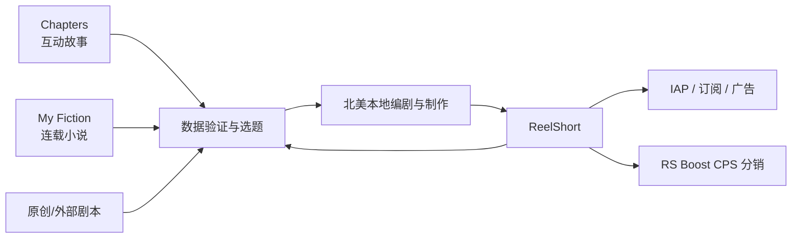
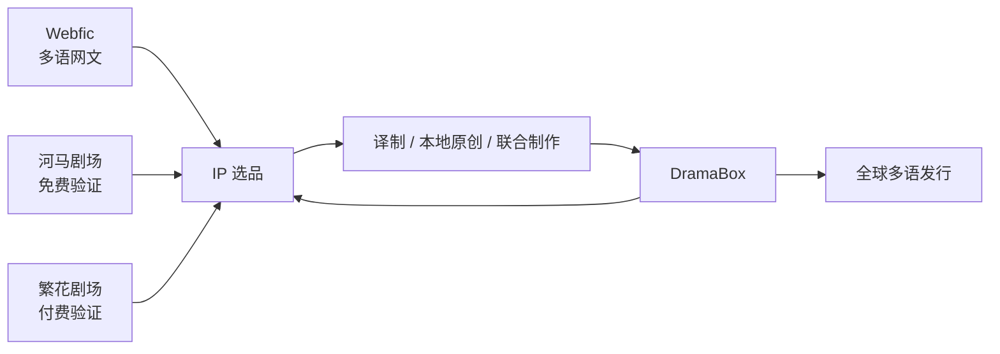
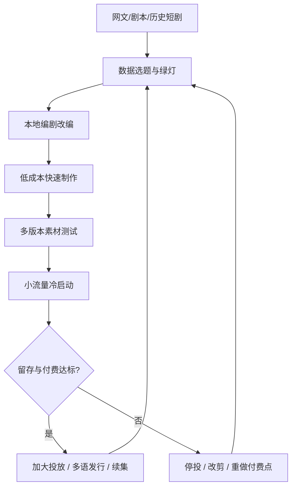

# 全球短剧平台格局与海外 IP 矩阵

> 调研日期：2026-08-11 | 产品类型：短剧流媒体平台与 IP 内容生态 | 数据截止：2026-08-11
>
> 证据等级：**[High]** 官方公告、监管文件、公司年报、应用商店；**[Medium]** Sensor Tower、QuestMobile、点点数据、AppsFlyer 等第三方监测；**[Low]** 基于公开数据的情景推演。第三方“收入”一般指 App Store 与 Google Play 的应用内购估算，不含广告、网页充值、第三方安卓商店，也不等于公司确认收入或利润。

## 一、产品总览

本报告的“产品”不是单一 App，而是由独立短剧 App、综合内容平台内短剧和上游 IP 公司共同构成的产品生态。官方产品文案中，红果使用「海量热门短剧随心看」，ReelShort 则围绕竖屏短剧观看体验定位；定位原文仅用于说明产品类别，不作为经营规模证据。

| 产品名 | 所属公司 | 营收 | 用户 | 商业模式 |
|---|---|---|---|---|
| 红果短剧 | 字节跳动/抖音集团生态 | 未单独披露 | 2025 年末 MAU 约 2.75 亿 **[Medium]** | 免费广告 + 会员 + 综合内容 |
| DramaBox | StoryMatrix；点众生态 | 公司营收未披露 | 2025 平均 MAU 约 3,106 万 **[Medium]** | IAP + 订阅 + 广告 + 内容合作 |
| ReelShort | Crazy Maple Studio | 公司营收未披露 | 2025 平均 MAU 海外第六 **[Medium]** | IAP + 订阅 + 广告 + CPS |
| GoodShort | Singapore New Reading Technology | 公司营收未披露 | 2025 平均 MAU 海外第五 **[Medium]** | IAP + 订阅 + 广告 + 内容合作 |

> **核心洞察**：短剧平台排名不能用一张“综合榜”概括；国内看独立 App MAU 与生态平台观看规模，海外至少要分下载、活跃和 IAP 三个维度。

1. **国内是“红果一超、河马跟随、生态平台另算”。** 2025 年底红果短剧月活约 2.75 亿，河马剧场约 4,720 万；红果、河马、繁花三家在独立短剧 App 中合计占据超过 95% 的月活渗透。快手短剧日活超过 3 亿，但它属于主 App 内的内容生态，不能与独立 App MAU 直接并表。
2. **海外不存在单一榜单冠军。** 2025 年 DramaBox 下载量和平均 MAU 第一，ReelShort 内购收入第一；到 2026 Q1，FreeReels 登顶下载榜，DramaBox 与 ReelShort 仍共同占据收入第一梯队。判断平台价值时必须分开看规模、付费、留存和获客依赖。
3. **海外头部平台的核心壁垒不是播放器，而是 IP 流水线。** ReelShort 背靠 Chapters/My Fiction，DramaBox 背靠 Webfic 与点众国内内容池，GoodShort 背靠 GoodNovel，ShortMax 背靠九州 4,000+ 部版权库，形成“网文验证—剧本改编—本地制作—多语发行—数据回流”的闭环。
4. **本地原创正在替代纯译制。** 早期出海靠中国成片翻译快速扩库，现阶段北美等高 ARPU 市场更偏好本地演员、本地叙事和强类型原创；译制仍适合低成本覆盖拉美、东南亚、中东等市场。
5. **若目标是联盟分销/内容合作，ReelShort 与 DramaBox 应走两条不同路径。** ReelShort 已有公开可验证的 RS Boost CPS 体系，适合先验证效果分成；DramaBox 的优势是规模、内容供给和全球发行，但目前公开可验证的是创作者/内容合作方案，不能把它等同于开放联盟计划。

## 二、关键数据趋势

| 时间 | 中国市场 | 海外市场 | 关键变化 |
|---|---|---|---|
| 2024 年末 | 微短剧用户约 6.62 亿 **[High]** | 美国贡献全球移动收入约 60% **[Medium]** | 国内全民化，海外以北美付费为核心 |
| 2025 全年 | 2025 年中用户约 6.96 亿 **[High]** | 全球短剧 App IAP 超过 28 亿美元 **[Medium]** | DramaBox 规模领先，ReelShort 付费领先 |
| 2026 Q1 | 国内头部结构基本稳定 **[Medium]** | 下载 8.5 亿+、IAP 约 7.5 亿美元 **[Medium]** | 新增量转向东南亚、拉美和印度 |

> **核心洞察**：2026 Q1 海外下载同比约增 140%，IAP 仅增约 20%；用户扩张速度明显快于付费扩张，说明免费广告和本地支付能力将比单纯复制北美付费墙更重要。

### 2.1 排名口径与市场边界

短剧平台至少包含三类，混排会导致错误结论：

| 类型 | 典型产品 | 正确指标 | 主要误区 |
|---|---|---|---|
| 独立短剧 App | 红果、DramaBox、ReelShort | MAU、下载、IAP、留存 | 把下载当用户，把 IAP 当公司收入 |
| 综合内容平台内短剧 | 抖音、快手、微信小程序 | 短剧 DAU、观看人数、内容供给 | 与独立 App MAU 直接排名 |
| 内容/IP 公司 | 点众、中文在线、九州文化 | 版权库、产能、发行网络、回收周期 | 只看旗下某个 App 的榜单名次 |

因此，本报告分别给出：国内独立 App 榜、国内生态平台观察、海外 2025 全年三张榜，以及 2026 Q1 趋势榜。

## 三、竞品对比

### 功能对比矩阵

| 平台 | 核心定位 | IP 上游 | 主要生产方式 | 公开合作入口 |
|---|---|---|---|---|
| ReelShort | 北美高付费竖屏短剧 | Chapters、My Fiction | 英语本地原创为主 | RS Boost CPS、作者平台 |
| DramaBox | 全球规模型短剧平台 | Webfic、点众 IP | 中国剧译制 + 本地原创 | 创作者/内容合作 |
| GoodShort | 网文生态延伸短剧 | GoodNovel 产品群 | 具体自制/改编率未披露 | 商务与内容供应 |
| ShortMax | 版权库驱动的全球发行 | 九州 4,000+ 部版权 | 译制 + 海外本地制作 | 集团商务合作 |

> **核心洞察**：ReelShort 的差异化是北美付费效率和公开 CPS；DramaBox 的差异化是规模与供给；ShortMax 的差异化是版权库与跨国制片；三者不应仅按下载排名判断合作价值。

### 3.2 TAM/SAM/SOM 市场规模测算

| 层级 | 定义 | 时间口径 | 当前量级 | 置信度 |
|---|---|---|---|---|
| TAM | 全球短剧 App 商店内购 | 2025 全年 | 28 亿美元以上 | **[Medium]** |
| SAM | 北美可服务的短剧 App 商店内购 | 参考 2024 美国约占 60%，并下调反映新兴市场增长 | 约 14—17 亿美元 | **[Low]** |
| SOM | GenGrowth 首 12 个月可验证获取的 SAM 份额 | CPS/内容合作试运行 | 0.01%—0.03% | **[Low]** |

TAM/SAM 不含广告与网页充值，因此是可比但偏保守的移动端支付口径。SOM 只表达可实现份额，用于设定验证目标，不把低证据强度的佣金收入伪装成市场事实。

> **核心洞察**：现阶段可决策的市场口径是商店 IAP，而不是“全行业产值”；先以 0.01%—0.03% 的可追踪份额验证渠道能力，比用不可审计的宏观市场规模倒推收入更可靠。

### 3.3 国内短剧平台排名

### 3.1 独立 App：2025 年可比排名

由于 2025 年底只披露了部分平台的绝对 MAU，完整排序采用 2025 年 1 月 QuestMobile 同口径数据，并补充年末最新值。

| 排名 | 平台 | 2025-01 MAU | 2025 年末最新观察 |
|---:|---|---:|---|
| 1 | 红果短剧 | 1.66 亿 | 约 2.75 亿 MAU，仍为绝对第一 |
| 2 | 河马剧场 | 3,766 万 | 约 4,720 万 MAU，稳居第二 |
| 3 | 繁花剧场 | 610 万 | 与红果、河马合计占独立 App 月活渗透 95%+ |
| 4 | 喜番 | 461 万 | 快手生态独立短剧产品 |
| 5 | 星芽 | 402 万 | 九州文化旗下国内短剧产品 |

数据来源：[QuestMobile 2025 年 1 月榜单转引](https://g.pconline.com.cn/x/1916/19164614.html)、[中国网络视听协会《2025 微短剧行业生态洞察报告》](https://www.cnsa.cn/art/2025/11/11/art_1955_47836.html)、[QuestMobile 2025 年末数据转引](https://finance.sina.com.cn/roll/2026-02-03/doc-inhkpeik7361167.shtml)。

### 3.2 平台业务与背后公司

| 平台 | 业务模式与定位 | 运营/背后公司 | 关键特点 |
|---|---|---|---|
| 红果短剧 | 免费短剧为主，广告变现；同时提供影视、小说、听书、漫画和会员 | 北京笔墨留香科技有限公司；字节跳动/抖音集团生态 | 依托抖音获客、推荐算法与番茄系 IP；内容形态从短剧扩为综合免费娱乐 |
| 河马剧场 | 免费短剧、广告变现，片库超过 1 万部 | 北京点众快看科技有限公司；点众科技 | 点众“网文—短剧—海外发行”链路的国内流量与内容验证入口 |
| 繁花剧场 | 付费短剧与快应用分发 | 点众科技 | 与河马形成免费/付费双产品组合，承接不同付费意愿用户 |
| 喜番 | 独立短剧 App，连接快手短剧内容生态 | 快手生态 | 可借助快手主站创作者、直播与广告系统，但公开独立经营数据有限 |
| 星芽 | 免费短剧与内容分发 | 嘉兴九州文化传媒有限公司 | 与九州剧场、ShortMax 共享版权和制作能力，形成国内外双发行 |

公司与产品依据：[红果 App Store 页面](https://apps.apple.com/cn/app/%E7%BA%A2%E6%9E%9C%E7%9F%AD%E5%89%A7-%E6%B5%B7%E9%87%8F%E7%83%AD%E9%97%A8%E7%9F%AD%E5%89%A7%E9%9A%8F%E5%BF%83%E7%9C%8B/id6451407032)、[点众产品页](https://www.dianzhongkeji.com/products.html)、[点众全球业务介绍](https://www.dianzhong.com/news_20250402.html)、[九州国内业务页](https://www.jxjzwh.cn/business-china.html)。喜番与快手的生态归属为公开行业归因，因缺少同等强度的一手主体披露，证据等级为 **[中]**。

### 3.3 国内内容生态平台：不与独立 App 混排

| 平台生态 | 规模信号 | 业务作用 | 对独立 App 的影响 |
|---|---|---|---|
| 快手 | 2025 年短剧 DAU 超过 3 亿；截至 2025 年 2 月已上线 5.3 万+ 部短剧 | 原生内容、达人分发、品牌短剧、付费投流与小程序承接 | 既是内容消费入口，也是独立 App/小程序的获客渠道 |
| 抖音 | 未采用公开不可比的短剧 MAU 数字 | 推荐分发、达人切片、广告投放、红果导流 | 与红果形成主站种草、独立 App 长时消费的协同 |
| 微信 | 未采用公开不可比的短剧 MAU 数字 | 小程序付费、私域触达、视频号分发 | 小程序曾是 IAP 短剧核心载体，监管和平台规则影响大 |

快手规模来源：[辽宁日报关于快手短剧生态的报道](https://economy.lnd.com.cn/system/2025/08/08/030523750.shtml)、[快手 2025 年全年业绩](https://ir.kuaishou.com/zh-hans/news-releases/news-release-details/kuaishoukejifabu2025niandisijidujiquanniancaiwuyeji)。

## 四、深度分析

### 4.1 变现与收入模式

头部海外 App 普遍采用“前几集免费—金币解锁/订阅—激励广告补充”的混合模式，并逐步增加网页充值、内容授权和 CPS。ReelShort 2025 年 IAP 估算约 3.32 亿美元、DramaBox 约 2.95 亿美元，属于第三方商店估算 **[Medium]**，不能等同于公司营收。

> **核心洞察**：同一平台既服务高付费用户，也通过广告变现免费用户；评估合作收益时必须把 IAP、广告、网页支付和渠道佣金拆开建模。

### 4.2 用户增长与获客

头部平台的规模主要由持续上新和付费买量共同驱动。2024 年 ReelShort 约 70% 下载来自付费投放，DramaBox 和 ShortMax 超过 60% **[Medium]**；2026 Q1 全球基准留存约 D1 15%、D30 2% **[Medium]**。

> **核心洞察**：短剧不是天然低 CAC 产品，素材工业化本身就是增长引擎；CPS 的价值在于把部分固定买量风险转移到可结算的效果成本。

### 4.3 竞争定位

#### 优势

生产周期短、类型验证快、网文 IP 供给丰富，且可通过字幕、配音与重拍复制到多个语言市场。

#### 劣势

留存普遍偏低、获客依赖买量、内容同质化明显，商店抽成和广告价格波动会直接影响单位经济。

#### 机遇

东南亚、拉美和印度贡献新增下载，本地原创、AIGC 本地化与联盟分销有机会提高内容供给和获客效率。

#### 威胁

综合视频平台争夺时长，订阅与隐私监管趋严，版权、音乐、肖像与误导素材可能造成下架和追偿。

> **核心洞察**：平台真正可持续的竞争定位来自“独有 IP + 本地产能 + 分发数据”组合，单靠低价买量或海量译制难形成长期壁垒。

### 4.4 产品类型专项分析

该赛道属于“移动内容订阅 + 免费广告 + IP 开发”的复合产品类型。内容是供给侧库存，推荐流是消费界面，付费墙是收入引擎，投放素材则同时承担获客与选题验证。

> **核心洞察**：短剧 App 更接近数据驱动的内容工厂，而非传统影视库；单剧表现、用户队列和创意素材需要在同一经营系统中闭环。

### 4.5 产品架构与技术栈

公开资料不足以确认各平台的具体云厂商或内部框架 **[Low]**。可以验证的产品能力层包括多语 CMS、推荐与实验系统、IAP/订阅、广告聚合、归因反作弊、字幕配音管线和版权资产管理；具体供应商应在商务尽调中确认。

> **核心洞察**：技术栈的决策价值不在猜测云服务品牌，而在确认平台能否按剧集、语言、国家和渠道提供可审计的内容与收入数据。

### 4.6 UX 与产品设计

通用体验是竖屏全屏播放、连续滑动、集尾悬念、金币/订阅付费墙和激励广告。高转化设计依赖素材承诺与首集内容一致、前三集快速起冲突、付费前提供足够价值；过早付费墙会放大卸载。

> **核心洞察**：短剧 UX 的核心不是导航复杂度，而是“首分钟承诺—连续悬念—透明解锁成本”的节奏设计。

### 4.7 Go-to-Market 策略

成熟打法是先用大量广告创意在 Meta、TikTok 等渠道验证题材，再扩大投放并做多语复制。进入高 ARPU 市场应优先本地原创，进入新兴市场则应结合免费模式、低价订阅和本地支付。

> **核心洞察**：GTM 应采用“题材 × 素材 × 市场 × 付费模式”四维实验，而不是把一部爆款用同一剪辑和价格机械复制到全球。

### 4.8 合规与监管

中国内容需落实许可/备案和先审后播；海外需处理自动续费、退款、隐私、广告披露、版权链和未成年人保护。联盟合作还需写明归因窗口、退款扣回、素材审批与反作弊。

> **核心洞察**：平台品牌、App 运营、版权、收款和签约主体可能不同；任何合作都应以合同主体与完整授权链为准，而不是以媒体所称“母公司”为准。

### 4.9 重点市场专项

| 市场 | 用户与收入特征 | 推荐产品策略 | 主要约束 |
|---|---|---|---|
| 北美 | ARPU 高、IAP 核心、D30 使用深 | 英语原创、本地演员、订阅 + IAP | 买量贵、订阅与版权风险高 |
| 拉美 | 下载和留存增长较好、价格敏感 | 西语/葡语、广告 + 低价包 | 支付能力与本地化质量 |
| 东南亚 | 2026 Q1 下载占比最大 | 免费广告、多语字幕、轻量产品 | ARPU 低、市场碎片化 |
| 印度 | 下载增长快、超低成本用户多 | 广告优先、本地语言、低价订阅 | 付费率和支付结构 |

> **核心洞察**：北美负责利润验证，新兴市场负责规模扩张；同一内容可以共享 IP，但不应共享完全相同的付费墙和变现组合。

### 4.10 海外短剧平台排名

### 4.1 2025 全年下载量 Top 10

| 排名 | 平台 | 运营主体/生态 | 判断 |
|---:|---|---|---|
| 1 | DramaBox | StoryMatrix；点众科技生态 | 全球用户规模第一梯队，多语译制与本地原创并行 |
| 2 | ReelShort | Crazy Maple Studio | 北美付费能力最强，原创英语剧与 IP 改编能力突出 |
| 3 | DramaWave | Skywork AI；昆仑万维生态 **[中]** | 2025 年快速放量的新头部 |
| 4 | GoodShort | Singapore New Reading Technology | 与 GoodNovel 网文生态相邻，内容池丰富 |
| 5 | NetShort | NETSTORY PTE. LTD. | 增长快，兼具广告、内购与订阅 |
| 6 | RapidTV | 公开可验证的最终控制主体不足 | 以高速买量获得规模，需进一步核验主体 |
| 7 | ShortMax | SHORTTV LIMITED；九州文化生态 | 北美为核心，译制与海外自制双线发展 |
| 8 | Melolo | 公开可验证的最终控制主体不足 | 2025 年新兴下载型平台 |
| 9 | FlickReels | FARSUN PTE. LTD. | 多语短剧发行平台 |
| 10 | FlareFlow | COL WEB；中文在线 | 依托中文在线 IP 库，2025 年上线后快速扩张 |

### 4.2 2025 全年应用内购收入 Top 10

| 排名 | 平台 | 2025 IAP 估算/信号 | 商业含义 |
|---:|---|---|---|
| 1 | ReelShort | 约 3.32 亿美元 **[中]** | 付费转化与北美 ARPU 领先 |
| 2 | DramaBox | 约 2.95 亿美元 **[中]** | 规模和付费兼具，综合实力最均衡 |
| 3 | GoodShort | 未披露可比绝对值 | 网文用户与短剧内容协同形成付费基础 |
| 4 | DramaWave | 未披露可比绝对值 | 新平台通过本地化原创和买量迅速进入头部 |
| 5 | NetShort | 未披露可比绝对值 | 混合变现和广泛市场覆盖带来增长 |
| 6 | ShortMax | 未披露可比绝对值 | 北美本地制作提升付费上限 |
| 7 | FlickReels | 未披露可比绝对值 | 进入收入榜说明不只是下载型产品 |
| 8 | FlareFlow | 未披露可比绝对值 | 中文在线自有 IP 与自产内容开始形成回收 |
| 9 | MoboReels | CHANGDU (HK) LIMITED；畅读科技 | 从网文/阅读生态延伸到短剧 |
| 10 | StardustTV | Hongxing Media Co., Limited | 垂类短剧发行平台 |

点点数据估算显示，ReelShort 和 DramaBox 2025 年 IAP 分别同比增长约 71.8% 和 46.3%。这些数字只用于平台间相对比较，不应写入财务模型中的公司收入。榜单来源：[点点数据《2025 年全球短剧市场报告》转引](https://doc.mbalib.com/view/b3535039fa7a6658beb62e3eb98deed4.html)、[相关研报 PDF](https://pdf.dfcfw.com/pdf/H3_AP202604261821586569_1.pdf?1777219052000.pdf=)。

### 4.3 2025 平均 MAU Top 10

| 排名 | 平台 | 平均 MAU 信号 | 与收入榜的差异 |
|---:|---|---:|---|
| 1 | DramaBox | 约 3,106 万 | 用户规模第一，收入第二 |
| 2 | ShortMax | 未披露绝对值 | 规模高于收入名次，仍有变现空间 |
| 3 | DramaWave | 未披露绝对值 | 新平台规模与收入同步进入前列 |
| 4 | NetShort | 未披露绝对值 | 规模领先，收入排名第五 |
| 5 | GoodShort | 未披露绝对值 | 收入效率高于规模名次 |
| 6 | ReelShort | 未披露绝对值 | MAU 第六而收入第一，付费效率最突出 |
| 7 | RapidTV | 未披露绝对值 | 高下载/规模，未进收入前十 |
| 8 | Melolo | 未披露绝对值 | 高下载/规模，变现仍待验证 |
| 9 | FlareFlow | 未披露绝对值 | 新品已形成较高活跃规模 |
| 10 | FlickReels | 未披露绝对值 | 规模与收入均进入前十 |

### 4.4 2026 Q1：格局正在怎样变化

| 观察维度 | 2026 Q1 结果 | 变化含义 |
|---|---|---|
| 下载量 Top 5 | FreeReels、ReelShort、NetShort、Melolo、DramaBox | FreeReels 以 1 亿+ 安装登顶，低门槛免费模式加速抢占新兴市场 |
| IAP 收入 Top 5 | DramaBox、ReelShort、NetShort、DramaWave、GoodShort | DramaBox 与 ReelShort单季均接近 1.4 亿美元，双强付费格局稳定 |
| 全球下载 | 超过 8.5 亿次，同比增长约 140% | 东南亚、拉美和印度成为新增量主战场 |
| 全球 IAP | 约 7.5 亿美元，同比增长约 20% | 下载增速远高于付费增速，新增用户主要来自低 ARPU 市场 |
| 地区下载占比 | 东南亚 32%、拉美 23%、印度 22% | 本地支付、低价订阅、广告变现和轻量包体更重要 |

来源：[Sensor Tower《State of Short Drama Apps 2026》](https://sensortower.com/blog/state-of-short-drama-apps-2026-report)、[AppsFlyer × Mintegral 2026 Q1 报告 PDF](https://a.storyblok.com/f/47007/x/9a9afd9c10/short-drama-apps-report.pdf)。

## 五、综合评估与建议

### 综合评分

5 分代表公开证据下的相对领先，评分只服务合作排序，不代表审计后的经营质量。

| 产品力（平台） | 增长 | 变现 | 竞争壁垒 | 市场前景 |
|---|---:|---:|---:|---:|
| ReelShort：5 | 4 | 5 | 5 | 5 |
| DramaBox：5 | 5 | 5 | 5 | 5 |
| GoodShort：4 | 4 | 4 | 4 | 4 |
| ShortMax：4 | 4 | 4 | 5 | 4 |
| NetShort：4 | 5 | 4 | 3 | 4 |
| FlareFlow：3 | 5 | 3 | 4 | 4 |

> **核心洞察**：DramaBox 的综合规模与 ReelShort 的付费效率都达到第一梯队；对 GenGrowth 而言，公开合作机制比单一榜单名次更影响短期可执行性。

### 估值参考

多数运营主体为私营公司，公开资料缺少可比融资估值、经审计分部收入和利润，不能可靠给出单点估值 **[Low]**。决策中应以三类替代指标跟踪：商店 IAP 相对排名、获客与留存质量、可控制 IP/自产内容占比。中文在线对 CMS 的持股账面信息也不等于 ReelShort 独立估值。

### 战略建议

1. 先用 ReelShort 的公开 RS Boost 做小预算 CPS 验证，建立归因、素材与结算能力。
2. 与 DramaBox 走内容供给/联合发行路线，不把创作者计划误当开放联盟计划。
3. GoodShort、NetShort、ShortMax 作为挑战者测试池，按主体透明度与合作条款逐一解锁。
4. 把跨语种素材、本地化改编与 IP 选品沉淀为可跨平台复用的能力，避免依赖单个平台政策。

### 风险矩阵

| 风险 | 发生可能性 | 影响 | 优先控制措施 |
|---|---|---|---|
| 获客成本上升、佣金覆盖不足 | 高 | 高 | 小预算分组测试，设置 D7/D30 停投线 |
| 版权或素材授权不完整 | 中 | 高 | 核验全链授权，合同写明切片、翻译、AI 和地域权利 |
| 自动续费/广告披露违规 | 中 | 高 | 购买前披露，素材审批，保留推广记录 |
| 平台主体或结算关系不透明 | 中 | 高 | 查验注册、收款、税务与授权主体 |
| 单个平台政策变化 | 高 | 中 | 建立多平台内容和流量组合 |

### 情景规划

| 情景 | 核心假设 | 2026 全球 App IAP | 2028 全球 App IAP |
|---|---|---:|---:|
| 悲观/保守 | 监管、买量和免费化压制付费 | 31 亿美元 | 40 亿美元 |
| 基准 | 北美稳健，本地原创和混合变现改善 | 34 亿美元 | 50 亿美元 |
| 乐观 | 新兴市场转化、网页支付和联盟明显改善单位经济 | 37 亿美元 | 63 亿美元 |

> **核心洞察**：三种情景均显示下载增速不会自然转化为同等收入增速；合作方案必须同时验证用户质量、平台净收入和佣金回收。

### 5.6 海外平台公司图谱

| 平台 | 可验证运营主体 | 中国/母公司生态 | 证据判断 |
|---|---|---|---|
| ReelShort | Crazy Maple Studio | 中文在线持股约 49.24%，属于参股/联营关系，并非并表子公司 | **[高]** CMS 官网、中文在线年报 |
| DramaBox | StoryMatrix Pte. Ltd. | 点众科技 | **[高]** 隐私政策、点众官网 |
| GoodShort | Singapore New Reading Technology Pte. Ltd. | New Reading/GoodNovel 产品群；最终中国控制主体未由一手资料确认 | **[高]** 运营主体；最终控制关系未验证 |
| DramaWave | Skywork AI Pte. Ltd. | 昆仑万维生态 | **[中]** 运营主体较明确，母公司归属主要来自行业报告 |
| NetShort | NETSTORY PTE. LTD. | 重庆麦芽传媒生态归因 | **[高]** 运营主体；母公司归因 **[中]** |
| ShortMax | SHORTTV LIMITED | 嘉兴九州文化传媒 | **[高]** 应用主体、九州官网 |
| FlickReels | FARSUN PTE. LTD. | 未验证更上层控制主体 | **[高]** 应用商店主体 |
| FlareFlow | COL WEB PTE. LTD. | 中文在线全资海外主体 | **[高]** 中文在线公告与年报 |
| MoboReels | CHANGDU (HK) LIMITED | 福州畅读信息科技 | **[高]** 畅读官网产品矩阵 |
| StardustTV | Hongxing Media Co., Limited | 未验证更上层控制主体 | **[高]** 应用商店主体 |

关键校正：市场资料常把 ReelShort 直接写成“中文在线旗下子公司”。根据中文在线 2025 年年报，Crazy Maple Studio 为参股/联营公司，中文在线持股约 49.24%、表决权约 47.81%，不应描述为中文在线并表子公司。[中文在线 2025 年年报 PDF](https://disc.static.szse.cn/disc/disk03/finalpage/2026-04-23/4706b0ea-dd78-41eb-b096-3bd85374704f.PDF)

## 六、头部平台的海外 IP 矩阵

### 6.1 一张表看清六个平台

| 平台 | 上游 IP/内容池 | 中游改编与生产 | 下游发行与变现 |
|---|---|---|---|
| ReelShort | Chapters 互动小说、My Fiction 连载小说、外部作者/原创剧本 | 美国本地编剧、演员、制片；网文数据验证后改编 | ReelShort；IAP、订阅、广告、RS Boost CPS |
| DramaBox | Webfic 多语网文、点众中文 IP、河马/繁花内容数据、外部创作者 | 中国成片译制 + 海外本地原创 + 联合制作 | DramaBox 全球发行；IAP、订阅、广告、内容合作 |
| GoodShort | GoodNovel、BueNovela、MegaNovel、GoodFM、外部作者 | 网文/UGC 内容池与短剧生产衔接，具体改编率未披露 | GoodShort；IAP、订阅、广告、版权/内容合作 |
| ShortMax | 九州 4,000+ 部短剧版权、国内已验证剧本 | 翻译发行 + 北美、日本、东南亚、英国本地制作；Moss AIGC 辅助 | ShortMax；IAP、订阅、广告，多语全球发行 |
| NetShort | 原创剧本、已出版热门小说、外部投稿 | 平台明确接受小说/剧本改编；本地化生产结构披露有限 | NetShort；IAP、订阅、广告，全球多语发行 |
| FlareFlow | 中文在线数字内容库、外部版权与原创 | 自制剧、译制、本地化；2025 年已有 700 部自制内容 | FlareFlow；IAP、订阅、广告，200+ 国家/地区 |

### 6.2 ReelShort：互动小说验证 IP，再用本地原创放大付费

**产品矩阵**

- Crazy Maple Studio 先做互动故事产品 Chapters，再将其 IP 与用户偏好用于 ReelShort。公司产品还包括连载小说 My Fiction，形成文字内容到视频的天然管线。
- ReelShort 以英语原创、本地演员和本地制作构建北美壁垒，核心类型包括霸总、狼人、复仇、契约婚姻，并向惊悚、动作扩展。
- 旗舰《The Double Life of My Billionaire Husband》公开累计观看超过 4.19 亿。公司披露单剧生产周期约三个月、制作预算通常低于 30 万美元，表现出“低预算、快反馈、高复用”的工业化特点。
- RS Boost 是目前头部平台中公开可验证度较高的 CPS 分销体系：推广者选择剧集、生成链接或推荐码，并按新用户消费获得分成。

来源：[Crazy Maple Studio 官网](https://cn.crazymaplestudios.com/)、[TIME 对 CMS CEO 的采访](https://time.com/7173765/reelshort-crazy-maple-studio-joey-jia-interview/)、[Chapters 创作者平台](https://ugc.crazymaplestudios.com/)、[RS Boost 资源广场](https://cps.reelshort.com/resource-square/detail/67f790bf2e5020721707e329?app=reelshort&book_type=0)。

### 6.3 DramaBox：点众把网文、国内短剧验证与全球发行连成一体

- Webfic 自 2019 年运营，点众披露其拥有约 8,000 万注册用户、2,000 部作品和 10+ 语言；它提供海外题材偏好和可改编文本。
- 河马剧场与繁花剧场分别承接国内免费和付费场景，可用播放、完播和付费数据筛选内容；DramaBox 承担全球商业化。
- 点众 2024 年披露 DramaBox 有 2,000+ 部短剧，约 95% 为中国短剧翻译版本，同时已推进本地原创；这说明其当前优势是超大内容供给，未来增量依赖原创占比提升。
- 《龙年大吉之衣锦还乡》被点众披露为海外播放超过 20 亿、充值超过 1,800 万美元的代表案例，证明中国内容经本地化仍可产生全球爆款。
- DramaBox 入选 2025 Disney Accelerator，说明其能力正在从发行 App 向全球制作与内容合作延伸。日本创作者页面提供最低保底加分成、非独家或独家发行选择，但这属于内容供应合作，不等于开放 CPS 联盟。

来源：[点众全球业务介绍](https://www.dianzhong.com/news_20250402.html)、[Disney Accelerator 2025](https://thewaltdisneycompany.com/disney-accelerator-companies-2025/)、[DramaBox 日本创作者计划](https://www.dramabox.jp/creators)。

### 6.4 GoodShort：网文矩阵完整，但短剧改编链透明度低于前两家

- New Reading 产品群覆盖 GoodNovel、面向西语/葡语市场的 BueNovela、偏男性题材的 MegaNovel、音频产品 GoodFM 和短剧 GoodShort。
- GoodNovel 披露拥有数十万部原创网文并覆盖 50+ 国家，这构成规模可观的潜在 IP 池；GoodShort 同时向出版商和内容提供方开放电子书、音频和短视频内容合作。
- 公开条款允许用户提交文学和视频内容，但未披露网文改编率、内部绿灯机制、自产比例。因此可确认“内容池邻接”，不能把所有 GoodNovel 内容都视作可直接改编资产。

来源：[New Reading 产品矩阵](https://www.goodnovel.com/about_us)、[GoodShort 商务合作](https://www.goodshort.com/business)、[GoodShort 隐私政策](https://www.goodshort.com/other/static_file/privacy_policy.html)。

### 6.5 ShortMax：以 4,000+ 部版权库做供给底盘，以海外制片提高 ARPU

- 九州文化披露拥有 4,000+ 部短剧版权、已发行 1,000+ 部；国内产品包括九州剧场、东篱短剧、星芽，海外核心产品为 ShortMax。
- ShortMax 采用“中国精品译制 + 海外本地自制”双模型，制作团队覆盖美国、日本、东南亚和英国；Moss AIGC 工具参与内容生产与本地化。
- 公司披露 ShortMax 覆盖 200+ 国家和地区、累计下载超过 2 亿、峰值 MAU 超过 3,000 万、DAU 超过 1,000 万。由于这些是公司披露口径，适合判断量级，不能与第三方平均 MAU 直接拼接。

来源：[九州文化公司介绍](https://www.jxjzwh.cn/about.html)、[ShortMax 海外业务页](https://www.jxjzwh.cn/business-abroad.html)。

### 6.6 NetShort：开放接受剧本和小说改编，适合测试供给合作

- NetShort 的官方 FAQ 明确接受原创剧本和已出版热门小说，并提供改编合作入口，这是其 IP 供应链最可验证的部分。
- 产品采取广告、内购和订阅混合变现，既可服务免费用户，也能从高意愿用户获得付费。
- 运营主体 NETSTORY PTE. LTD. 已验证；行业通常将其归入重庆麦芽传媒生态，并关联国内“麦萌短剧”，但缺少同等级官方集团披露，合作尽调时必须再次核验版权主体、结算主体和地区授权。

来源：[NetShort FAQ](https://netshort.com/faq)、[NetShort 隐私政策](https://netshort.com/privacyPolicy.html)。

### 6.7 FlareFlow：中文在线的全资海外新平台，值得作为“第六矩阵”跟踪

- FlareFlow 于 2025 年 4 月上线，由中文在线全资海外主体 COL WEB 运营，区别于中文在线参股的 ReelShort。
- 中文在线 2025 年年报披露：平台覆盖 200+ 国家和地区、14+ 语言、注册用户约 3,300 万，上线 5,200+ 集内容，其中 700+ 集为自制。
- 上游可直接调用中文在线数字内容库并做全生命周期开发，因此在组织协同和版权控制上更强；短板是产品运营时间短，留存、单位经济和持续爆款能力仍需验证。

来源：[中文在线关于 FlareFlow 的官方信息](https://col.com/article/1959876057200820224)、[中文在线 2025 年年报 PDF](https://disc.static.szse.cn/disc/disk03/finalpage/2026-04-23/4706b0ea-dd78-41eb-b096-3bd85374704f.PDF)。

## 七、业务模型与单位经济

### 7.1 主流变现结构

| 变现方式 | 用户机制 | 平台收益 | 适用市场/风险 |
|---|---|---|---|
| 单集金币/IAP | 前若干集免费，关键节点解锁 | 高付费深度，能快速回收爆款 | 北美等高 ARPU 市场；付费墙过急会伤留存 |
| 周/月订阅 | 无限看或每日币包 | 收入可预测、提高 LTV | 自动续费披露与取消路径必须清晰 |
| 激励广告 | 看广告解锁剧集/金币 | 覆盖低付费用户 | 新兴市场重要；广告密度过高伤体验 |
| 网页充值 | 绕开部分商店费率，更多支付方式 | 改善毛利和支付成功率 | 需遵守商店导流、税务与支付规则 |
| CPS/联盟 | 推广者按新用户消费分成 | 将固定买量转为效果付费 | 需防归因作弊、素材侵权和品牌失控 |
| 内容分销/联合制作 | 保底、版权费、流水分成 | 扩充片库并分摊制作风险 | 权利链、地域、期限和二创条款复杂 |

### 7.2 获客与留存现实

- 2024 年 Sensor Tower 观察到，ReelShort 约 70% 的下载来自付费投放，DramaBox 和 ShortMax 也超过 60%。头部规模仍高度依赖买量，创意生产速度和素材转化率是核心经营能力，而非辅助能力。
- 2026 Q1 全球短剧 App 基准留存约为 D1 15%、D30 2%；拉美约 D1 20%、D30 4%，北美约 D1 10%、D30 3%。北美早期留存不高，但付费能力和长期使用时长更强。
- 到第 30 天，全球用户日均使用时长约 37.7 分钟，北美约 40.9 分钟、欧洲约 32.2 分钟。留存一旦建立，消费深度并不弱。
- DramaBox 早期批次曾达到第 6 个月约 17%、第 12 个月约 15% 的月度留存，说明长尾片库和持续上新能够形成回访，但该口径不能与日留存直接比较。

来源：[Sensor Tower 2024 行业分析](https://sensortower.com/blog/short-drama-redefines-mobile-entertainment-and-challenges-games)、[AppsFlyer × Mintegral 2026 Q1 报告 PDF](https://a.storyblok.com/f/47007/x/9a9afd9c10/short-drama-apps-report.pdf)。

## 八、产品与内容工业化能力

### 8.1 典型生产闭环

### 8.2 头部共同方法

1. **题材先验强。** 霸总、身份反转、复仇、狼人、禁忌关系等题材具备低理解成本和强钩子，适合 1—2 分钟竖屏单集。
2. **前三集决定经济性。** 开头必须快速完成冲突、身份或承诺，广告素材与正片首集要保持承诺一致，否则安装转化高但留存差。
3. **每 30—90 秒设置悬念。** 付费点、广告解锁点和集尾钩子被纳入剧本结构，而不是上线后再添加。
4. **本地化不等于翻译。** 人名、阶层、家庭关系、法律常识、演员表演和场景都影响可信度；高价值市场需要重写或重拍。
5. **内容复用率决定供给效率。** 同一 IP 可拆为小说、音频、互动故事、短剧、切片素材和多语版本，头部平台用矩阵摊薄获客和制作成本。

## 九、竞争结构

### 9.1 SWOT：海外短剧 App 赛道

| 优势 | 劣势 |
|---|---|
| 内容生产周期短、试错成本低；移动端沉浸强；网文 IP 供给丰富；可快速多语复制 | 获客高度依赖付费投放；D30 留存普遍低；题材同质化；应用商店抽成与广告波动侵蚀利润 |
| 机会 | 威胁 |
| 东南亚、拉美、印度新增量；AIGC 降低译制与素材成本；本地原创扩展题材；联盟分销降低前置买量 | 平台监管收紧；自动续费与广告投诉；版权/肖像/音乐侵权；综合视频平台与免费新 App 抢时长 |

### 五力分析（Porter's Five Forces）

| 力量 | 强度 | 判断 |
|---|---|---|
| 现有竞争 | 高 | 榜单变化快，买量和内容模仿速度高，双强也面临 FreeReels、DramaWave 等新玩家 |
| 新进入者 | 中高 | App 与译制门槛低，但稳定 IP、全球投放、支付和本地制作门槛高 |
| 替代品 | 高 | TikTok/YouTube Shorts、流媒体、网文、手游都在争夺碎片时间 |
| 供应商议价 | 中 | 普通内容供给多，优质 IP、本地演员、成熟制作团队仍稀缺 |
| 用户议价 | 高 | 切换成本极低，免费替代品多，付费墙稍激进就会流失 |

## 十、监管与合作风险

### 10.1 中国内容与发行

- 国家广电总局要求微短剧落实许可/备案、内容审核和“先审后播”，并按不同投资规模实施分类分层管理。[2025 年管理提示](https://www.nrta.gov.cn/art/2025/2/5/art_113_70148.html)
- 2026 年 6 月公开征求意见的《微短剧管理办法》进一步覆盖制作、播出、推荐和变更备案；正式版本落地前应把它视为政策方向而非既成条文。[征求意见稿](https://www.nrta.gov.cn/art/2026/6/24/art_113_73514.html)

### 10.2 海外发行与联盟合作

1. **版权链。** 合同需逐项确认小说、剧本、成片、音乐、演员肖像、素材切片、翻译、AI 训练/生成、地域和期限授权。
2. **订阅与付费。** 首次价格、试用期、自动续费、取消方式和退款规则要在购买前清楚展示；美国各州、欧盟与应用商店规则需要分别核对。
3. **隐私与归因。** SDK、设备标识、跨境传输、未成年人数据要满足 GDPR、CCPA/CPRA 及当地要求；CPS 归因窗口和反作弊规则需写入合同。
4. **广告与推广披露。** 联盟推广者须披露商业关系，不能用与正片不一致的误导素材；平台需保留素材审批、下架和追偿权。
5. **主体尽调。** 品牌、App 运营主体、版权主体、收款主体可能不同。签约前必须核验公司注册、授权链、税务和结算账户。

## 十一、对 GenGrowth 的合作优先级建议

### 11.1 决策评分卡

评分采用 1—5 分，反映当前公开证据下的相对适配度，不代表平台绝对经营质量。

| 平台 | 用户/收入质量 | IP 与供给 | 可验证合作入口 | 建议优先级 |
|---|---:|---:|---:|---:|
| ReelShort | 5 | 5 | 5：RS Boost CPS 已公开 | 1 |
| DramaBox | 5 | 5 | 3：内容合作清晰，公开 CPS 未验证 | 2 |
| GoodShort | 4 | 4 | 3：商务/内容入口清晰，联盟待确认 | 3 |
| NetShort | 4 | 3 | 3：剧本/小说合作清晰，主体需复核 | 4 |
| ShortMax | 4 | 5 | 2：集团能力强，公开联盟入口不足 | 4 |
| FlareFlow | 3 | 5 | 2：新平台，公开合作机制有限 | 5 |

### 11.2 推荐行动顺序

**第一阶段：用 ReelShort 验证 CPS 模型。**

- 申请并核验 RS Boost 的地区、归因窗口、首购/续费分成、退款扣回、结算周期和素材权限。
- 选择 3—5 部高转化题材，分别制作剧情解说、钩子剪辑、榜单推荐三类素材，在英语高购买力流量与拉美低成本流量间做对照。
- 核心指标：点击到安装、安装到付费、每付费用户佣金、D7 回收、退款率、账号/素材封禁率。

**第二阶段：与 DramaBox 并行谈内容供给/联合发行。**

- 不预设其存在开放 CPS，优先谈站外导流、内容版权、创作者供给或地区联合发行。
- 用“保底 + 阶梯分成”替代纯买断，要求按剧/国家/渠道提供可审计数据。
- 对中国成片出海，先用低成本字幕/配音测试；达到留存和付费阈值后再投入本地重拍。

**第三阶段：建立挑战者测试池。**

- GoodShort：验证网文内容合作和短剧分销能否统一签约。
- NetShort：从公开剧本/小说入口切入，但签约前核验麦芽生态归属、版权和结算主体。
- ShortMax：适合以成熟版权和本地制作合作切入，而非先假设有联盟计划。
- FlareFlow：持续跟踪其自制剧增速、北美收入排名和对外合作开放度。

### 11.3 30 天尽调清单

| 周期 | 核心动作 | 交付物 |
|---|---|---|
| 第 1 周 | 完成六个平台主体、联系人、合作入口、地区与产品条款核验 | 平台尽调表与联系人清单 |
| 第 2 周 | 获取 ReelShort/DramaBox 等实际结算和素材规则，选定测试内容 | 合同差异表、首批剧单 |
| 第 3 周 | 制作 3 种创意框架 × 3 个市场版本，小预算投放 | 素材库与实验看板 |
| 第 4 周 | 复盘安装、付费、佣金、退款和合规问题 | Go/No-Go 决策与下一轮预算 |

## 十二、2026—2028 市场情景推演

2025 年全球短剧 App IAP 超过 28 亿美元；2026 Q1 约 7.5 亿美元。考虑到下载向低 ARPU 市场迁移，未来收入增速大概率低于下载增速。

| 情景 | 关键假设 | 2026 IAP | 2028 IAP |
|---|---|---:|---:|
| 保守 | 监管、买量成本和免费化压制付费，年复合增速约 13% | 31 亿美元 | 40 亿美元 |
| 基准 | 北美稳健、本地原创改善转化，新兴市场广告补足，年复合增速约 21% | 34 亿美元 | 50 亿美元 |
| 乐观 | 免费用户规模成功转化、网页支付和联盟显著改善单位经济，年复合增速约 31% | 37 亿美元 | 63 亿美元 |

以上为 **[低]** 证据等级的决策情景，不是行业预测。计算基于 2025 年 28 亿美元基数与 2026 Q1 年化信号；不包含广告收入和非商店支付，因此只适用于观察移动端 IAP 的相对空间。2025 基数来源：[Sensor Tower 2025 市场数据转引](https://www.cnfin.com/gs-lb/detail/20260114/4365190_1.html)。

## 十三、最终判断

海外短剧竞争已从“翻译中国成片并买量”进入“IP 数据化、制作本地化、发行多区域化、变现混合化”的第二阶段。DramaBox 更像规模与内容供给平台，ReelShort 更像北美付费效率与 IP 改编平台，GoodShort/ShortMax/NetShort 各自依靠网文或版权库追赶，FreeReels、DramaWave、FlareFlow 则代表免费化和新供给的变量。

对 GenGrowth 而言，最优进入方式不是自建一个同质化播放器，而是先占据头部平台之外的高杠杆环节：**效果分销、跨语种素材生产、可验证的 IP 选品、本地化改编和内容供给撮合**。先用 ReelShort 的公开 CPS 跑通数据闭环，再把能力迁移到 DramaBox 等平台的商务合作，风险最低、学习速度最快。

## 参考来源

- [中国网络视听协会：2025 微短剧行业生态洞察](https://www.cnsa.cn/art/2025/11/11/art_1955_47836.html)
- [中国网络视听协会：2025 年中用户规模](https://www.cnsa.cn/art/2025/7/17/art_1955_47260.html)
- [Sensor Tower：State of Short Drama Apps 2026](https://sensortower.com/blog/state-of-short-drama-apps-2026-report)
- [Sensor Tower：Short Drama Redefines Mobile Entertainment](https://sensortower.com/blog/short-drama-redefines-mobile-entertainment-and-challenges-games)
- [AppsFlyer × Mintegral：2026 Q1 Short Drama Apps Report](https://a.storyblok.com/f/47007/x/9a9afd9c10/short-drama-apps-report.pdf)
- [点点数据：2025 年全球短剧市场报告转引](https://doc.mbalib.com/view/b3535039fa7a6658beb62e3eb98deed4.html)
- [Crazy Maple Studio](https://cn.crazymaplestudios.com/)
- [点众科技全球业务](https://www.dianzhong.com/news_20250402.html)
- [九州文化海外业务](https://www.jxjzwh.cn/business-abroad.html)
- [中文在线 2025 年年报](https://disc.static.szse.cn/disc/disk03/finalpage/2026-04-23/4706b0ea-dd78-41eb-b096-3bd85374704f.PDF)
