# Facebook 账号新手操作教程

**Mac＋AdsPower / iPhone＋Shadowrocket｜SOCKS5 代理版**  
更新：2026 年 10 月 14 日

这份教程教你准备账号、连接已购买的代理、注册或登录 Facebook，以及登录后的日常使用和异常检查。

**先看第 1、2 节，再按设备选一条路线，最后看第 5、6 节。两条路线不用都做。**

| 你用什么设备 | 跟着哪一节做 |
| --- | --- |
| Mac 电脑 | 第 3 节：Mac＋AdsPower |
| iPhone | 第 4 节：Shadowrocket＋Facebook App |

按钮同时给出常见中英文名称。软件更新后位置可能变化，优先找对应名称；遇到与本文不同的验证要求，以你账号当前显示的提示为准。

**看图时怎么用：** 先读步骤，再对照图片找按钮。截图中的账号、地址、端口、版本号和分组都是来源中的演示内容，填写时使用自己的资料。每张图下方注明来源；旧版界面与当前界面不同时，按图注和正文操作。

## 1. 开始前，把这些东西准备好

### 1.1 账号资料

**准备自己注册：** 准备自己长期使用、能收验证码的邮箱或手机号，以及一个单独用于 Facebook 的密码。先确认邮箱能打开、手机号能收短信。

**已经有账号：** 向交接人拿到可用的登录邮箱／手机号／用户名、Facebook 密码，以及二次验证和绑定邮箱的交接说明。只有一串 UID 时，先问清楚可用的登录方式。UID 是账号编号，不是密码。

**Mac 用户额外准备：** AdsPower 的登录账号。团队已有工作空间时，让管理员提供本人可用的访问方式。AdsPower 账号和 Facebook 账号是两回事。

**iPhone 用户额外准备：** 自己可用的 Apple 账户，用于在 App Store 下载 Shadowrocket 和 Facebook。

账号名单另行保存。本教程不填写真实密码、验证码、恢复码或 2FA 密钥。

### 1.2 从代理供应商拿齐五项信息

本教程先使用 **SOCKS5＋用户名密码认证** 。资料不全时先找供应商补齐，不要猜。

| 供应商给你的信息 | 是什么 | 演示值，不能直接使用 |
| --- | --- | --- |
| 协议 / Type | 连接方式 | SOCKS5 |
| 地址 / Host / Server | 代理服务器地址 | proxy.example.com |
| 端口 / Port | 服务器的连接端口 | 1080 |
| 用户名 / Username | 代理服务的账号 | 供应商给的代理用户名 |
| 密码 / Password | 代理服务的密码 | 供应商给的代理密码 |

供应商可能把四项写在一行：`地址:端口:用户名:密码`，也可能写成 `用户名:密码@地址:端口`。 **按供应商标注拆开填写，不能只看顺序猜。** 密码里有特殊符号时，优先让供应商分别列出四项。

这里的“手机 IP”指购买的代理服务。用在手机上，不代表它一定属于移动运营商；具体地区、静态或动态、住宅或移动类型，以订单为准。

还要向供应商确认两件事：

- 当前 Wi-Fi／移动网络能否直接连接这个代理，是否需要白名单或额外的前置连接。
- 套餐是否有效，预期的出口地区是什么，是否允许当前设备使用。

**分清两个地址：** 填进软件的是“代理服务器地址”；IP 检测网站显示的是“出口 IP”，即网站看到的网络出口。二者可能不同，不要拿检测结果擅自替换服务器地址。

## 2. 账号获取：自己注册，或接收已有账号

### 2.1 自己注册

先把所选设备的代理配置好，再在 Facebook 中注册。Mac 的完整步骤见 **3.5 A** ；iPhone 见 **4.5 A** 。

注册的是 Facebook 个人账号。这里先完成登录与日常使用，公共主页创建留到后续教程。

### 2.2 原资料中的买号渠道

**排除 AiToEarn 后，现有资料没有提供可直接使用的 Facebook 买号店名、购买网址或联系人。** 资料 1 只提到下面两种来源，因此如需买号，要先向提供资料的人确认具体商家。

| 原资料中的渠道说法 | 来源 | 目前能确认到哪里 |
| --- | --- | --- |
| 第三方平台 | [资料 1：Facebook 账号运营标准化 SOP](https://inbeidou.feishu.cn/wiki/Z30HwDQkBik9d6kZjWsc1Ny9nub) | 未写平台名称或购买链接 |
| 熟人推荐 | 同上 | 未写联系人或联系方式 |

资料 2、3 中的[七星海外短剧&小说推广资源汇总表单](https://my.feishu.cn/wiki/MQgmwBoDti3Lt2k4yE6cEUfsnxb)已核对：两张工作表分别是“海外短剧合集”和“海外小说合集”，内容为剧单、书单、推广说明及锚点等，没有列出 Facebook 买号商家。它属于素材与推广资源，见下节。

本章仅整理老板提供的资料，不从互联网另加卖家。拿到具体渠道后，先问清交付的账号资料、是否能接收验证码、当前账号状态及交接责任，再按 **2.4** 检查登录条件。具体渠道和交付资料记在另行管理账号的位置。

### 2.3 资料中的工具与素材入口

这些是工具和素材链接，不是已经核实的买号渠道。

| 入口 | 实际用途 | 在本教程中怎么用 |
| --- | --- | --- |
| [AdsPower 原资料入口](https://www.adspower.net/share/kefubu) | 指纹浏览器入口，来自资料 5 | 软件安装优先用第 3 节的官方下载页 |
| [七星剧浪](https://www.injulang.cn/) | 选剧、素材／推广平台，来自资料 2 | 留作后续内容运营参考 |
| [七星海外短剧&小说推广资源汇总表单](https://my.feishu.cn/wiki/MQgmwBoDti3Lt2k4yE6cEUfsnxb) | 剧单、书单、推广说明及锚点等，来自资料 2、3 的内链 | 已核对两张工作表；留作后续内容运营参考 |
| [爱思助手](https://www.i4.cn/) | 手机管理工具，来自资料 3 | 本次正常安装 App 和登录流程不需要用它刷机 |
| [Ping0](https://ping0.cc/) | IP 信息查询，资料 1 提及 | 可辅助查看出口信息 |
| [IP111](https://ip111.cn/) | 网络出口检测，资料 2 提及 | 可辅助排查网络 |
| [Scamalytics](https://scamalytics.com/) | IP 信息与风险评分，资料 2 提及 | 评分不能代表 Facebook 账号是否正常 |
| [Whoer](https://whoer.net/) | 出口 IP 与网络信息，资料 3 提及 | 两条路线都可用来检查出口 |

以上工具与素材入口 **没有被原资料明确标为 Facebook 卖号商家** ，不能直接当成买号渠道。资料 3 另写了 `Pinfo.io`，其真实指向未确认，暂不作为点击操作入口。

### 2.4 已有／交付账号，先确认能否完成登录

拿到账号资料后，先确认：

- 登录标识和 Facebook 密码分别是什么。
- 绑定邮箱或手机号由谁保管，验证码能否收到。
- 若开启了 2FA（二次验证），由什么方式生成验证码。
- 当前是否有锁定、停用或待完成的身份验证；账号来源、可用权限及交接责任是否清楚。

缺少其中的登录必需信息，先找交接人补齐。不要通过反复试密码、反复重发验证码来碰运气。后续若出现身份核验，按平台要求由符合条件的本人完成，不用他人的姓名或证件代替。

## 3. 路线一：Mac＋AdsPower

**这条路线的顺序：安装软件 → 新建环境 → 填代理 → 检查连接 → 注册或登录 → 下次打开同一环境。**

“环境”可以理解成一份独立保存的浏览器工作区。给它起一个容易识别的名字，以后从这份环境继续使用账号。

### 3.1 安装 AdsPower

1. 在 Mac 左上角点击 ** → 关于本机** ，查看“芯片”或“处理器”。
2. 打开 [AdsPower 官方下载页](https://www.adspower.com/download)。Apple M 系列选 **macOS / Apple Silicon** ；Intel 处理器选 **macOS / Intel** 。同时核对下载页的系统要求。
3. 下载后双击 `.dmg` 文件，把 AdsPower 图标拖入 **Applications／应用程序** 。
4. 从“应用程序”打开 AdsPower，登录自己的 AdsPower 账号。没有账号时，在官方入口注册；团队已提供账号时按管理员交接方式进入。
5. 如果首次启动需要下载浏览器内核，等待完成。内核是 AdsPower 用来打开网页的浏览器组件。

**看到什么算完成：** 能进入 AdsPower 主界面，找到“环境管理”和“新建环境／新建浏览器”。

若安装包打不开、提示系统不兼容，先核对芯片版本和系统要求，不要反复下载同一个错误版本。[官方安装图文](https://www.adspower.com/tc/blog/adspower-browser-install-guide)

**图 1｜Mac 下载入口：先分清 Apple Silicon 和 Intel**

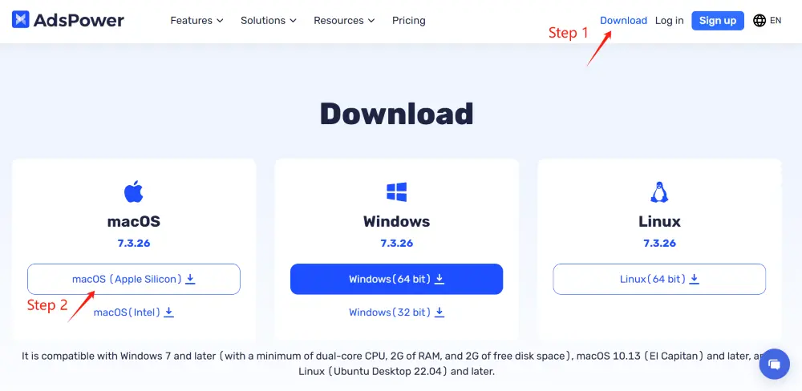

看左侧 macOS 区域：M 系列选 Apple Silicon，Intel 选下方 Intel。图中的版本号和旧系统要求仅为历史画面，下载时以当前官网为准。 图片来源：[AdsPower 官方安装教程](https://www.adspower.com/tc/blog/adspower-browser-install-guide)。


### 3.2 新建一份浏览器环境

1. 点击 **新建环境／新建浏览器（New Profile）** 。
2. 名称填写自己容易识别的编号，例如 `FB_01_Mac`。不要把密码写在环境名称里。
3. 浏览器可先使用 **SunBrowser** 。其他指纹参数无特殊要求时保留默认值。
4. 没有经过确认的 Cookie 文件时，把 **Cookie** 一栏留空。这里不是粘贴账号密码的地方。
5. 找到 **代理信息／Proxy** ，接着做下一步。

团队已交付完整环境时，先确认环境名称和账号归属，检查原有配置即可，不必再建一份。

**图 2｜新建环境：名称、浏览器和 Cookie 在这里**

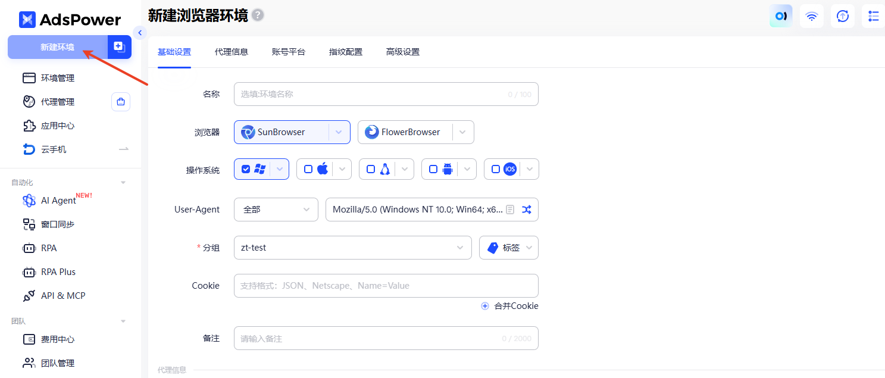

先点左上角“新建环境”，再填写名称。Cookie 留空。图中 Windows、分组等来自官方演示；在 Mac 上按本机／团队默认配置操作，不必照搬这些值。 图片来源：[AdsPower 官方创建环境教程](https://help.adspower.net/docs/j0c1p3)。


### 3.3 填入购买的 SOCKS5 代理

在代理信息区域选择 **自定义（Custom）** ，逐项填写：

| AdsPower 的字段 | 填什么 |
| --- | --- |
| 代理类型 | Socks5 / SOCKS5 |
| 代理主机 | 供应商给的地址，只填主机或 IP，不加 `https://` |
| 代理端口 | 供应商给的端口数字 |
| 代理账号 | 代理用户名，不是 Facebook 邮箱 |
| 代理密码 | 代理密码，不是 Facebook 密码 |

1. 核对五项，尤其检查是否多复制了空格、换行。
2. 点击 **检查代理（Check Proxy）** 。
3. 显示 **连接测试成功** 后，核对检测到的出口地区是否符合订单。
4. 如果显示失败，先去第 **6.1 节** 排查，暂不继续 Facebook 登录。

**“检查代理成功”只说明连接测试通过，还需要在环境内实际打开网页。** [官方代理配置教程](https://help.adspower.net/docs/k1a68p)

**图 3｜SOCKS5 代理：填写四项，再点检查代理**

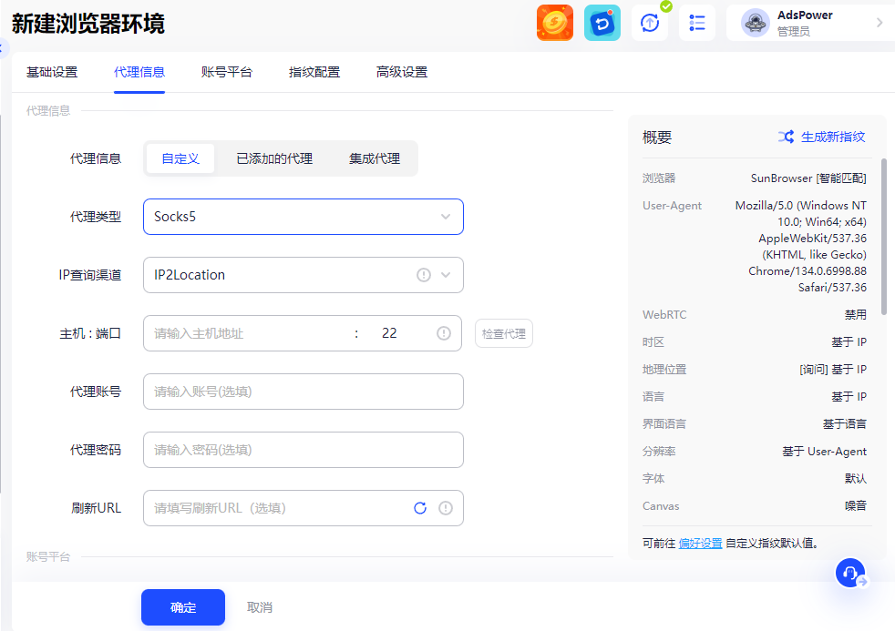

按从上到下的顺序找“自定义 → Socks5 → 主机与端口 → 代理账号 → 代理密码”。主机与端口可能放在同一行；图中的端口 22 不是本教程规定值，必须换成供应商给的端口。填好后点右侧“检查代理”，通过后再保存。 图片来源：[AdsPower 官方创建环境教程](https://help.adspower.net/docs/j0c1p3)。


### 3.4 保存环境，再检查实际网络

1. 在“账号平台”中选择 **Facebook** ；没有该选项时，在“标签页／启动网址”填入 `https://www.facebook.com/`。
2. Facebook 用户名、密码可以先留空，打开网页后再输入。高级指纹设置先保持默认。
3. 点击 **确定／保存** 。
4. 回到 **环境管理** ，找到 `FB_01_Mac`，点击 **打开（Open）** 。
5. **在刚刚打开的 AdsPower 浏览器窗口里** 访问 [Whoer](https://whoer.net/)，查看出口 IP 和地区。不要拿外面的 Safari 检测结果代替。
6. 检查出口是否符合供应商说明，然后访问 [Facebook](https://www.facebook.com/)，确认登录页能正常加载。

**通过标准：** 环境能打开、出口信息符合说明、Facebook 登录页能加载。检测网站的“伪装度／风险分”不是 Facebook 的通过证明，无需为了凑满分随意修改配置。

[官方创建环境教程](https://help.adspower.net/docs/j0c1p3)提供了对应界面图。

**图 4｜保存后，从环境管理打开原来的环境**

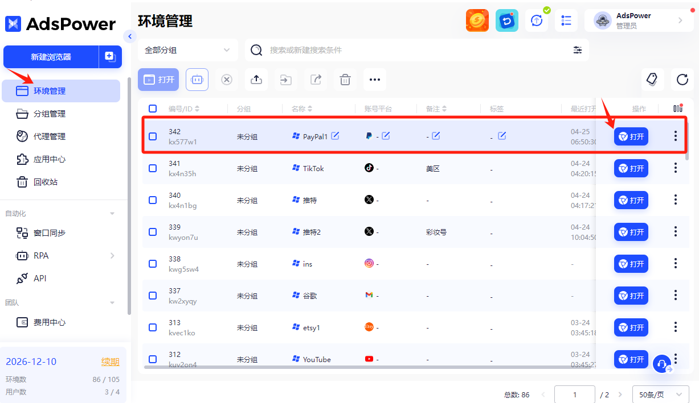

看左侧“环境管理”和每一行右侧的“打开”。你应找到自己命名的 FB_01_Mac；图中框选的是官方演示环境，不用选择 PayPal 或其他平台。下次使用也从同一行打开。 图片来源：[AdsPower 官方创建环境教程](https://help.adspower.net/docs/j0c1p3)。


### 3.5 注册或登录，选一种做

**图 5｜Facebook 网页入口：登录与创建新账户**

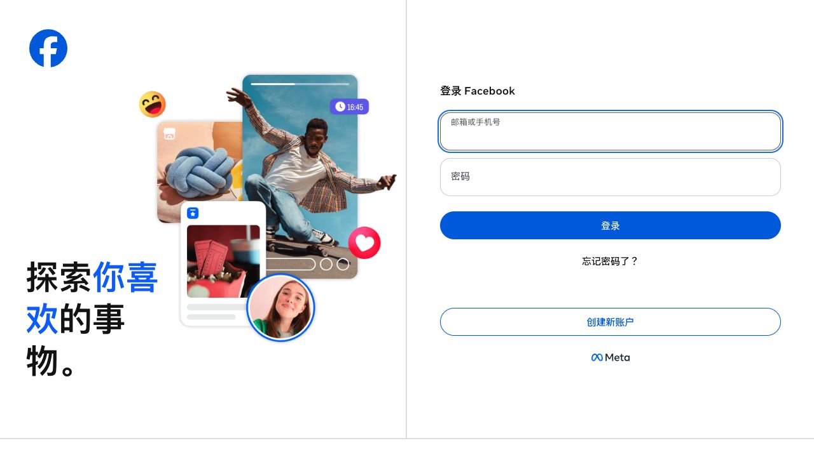

有账号时填右侧邮箱／手机号和 Facebook 密码；没有账号时点下方“创建新账户”。这张图仅展示网页入口，不代表已经通过代理或登录验证。 图片来源：[Facebook 公共登录页，本次截图](https://www.facebook.com/)。


#### A. 还没有 Facebook 账号：自行注册

1. 留在刚才的 AdsPower 窗口，打开 Facebook，点击 **创建新账号（Create new account）** 。
2. 填写本人实际使用的姓名、生日，以及界面要求的其他信息。个人姓名不填公司名，不套用教程截图里的姓名或生日。
3. 输入长期可用的邮箱或手机号；使用手机号时核对国家／地区代码。
4. 设置 Facebook 密码，核对信息后提交注册。
5. 按页面要求去邮箱或短信收取验证码，回到这份环境输入；如果收到的是确认链接，复制该链接地址，粘贴到同一 AdsPower 环境的地址栏打开，完成后回 Facebook 检查确认状态。确认链接也不要转发给别人。
6. 其余资料完善、联系人同步等步骤按实际需要处理。出现验证码或身份核验时先完成当前提示，不重复创建账号。

**完成标志：** 进入信息流，能打开自己的个人资料，并且没有未完成的注册确认提示。之后去第 **5.1 节** 检查账号。

注册时收不到验证码或被提示暂时无法创建，按第 6 节处理，不把“重建环境再试”当作常规步骤。

**图 6｜Facebook 空白注册表单**

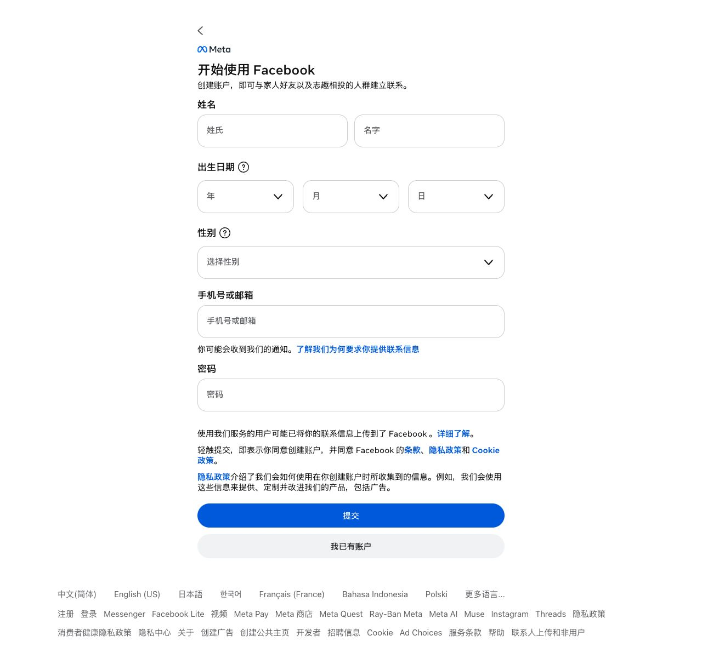

依次核对姓名、真实生日、性别、手机号／邮箱和密码。截图没有填写或提交任何资料；你操作时还要完成之后出现的邮箱、短信或身份确认。 图片来源：[Facebook 公共注册页，本次截图](https://www.facebook.com/reg/)。


#### B. 已经有 Facebook 账号：直接登录

1. 在 Facebook 登录页填入该账号的登录邮箱／手机号／用户名。
2. 密码框填 **Facebook 密码** ，点击 **登录（Log in）** 。
3. 如要求二次验证码，从账号已绑定的验证器、短信或其他可用方式取得验证码，再填回 Facebook。
4. 登录后打开个人资料，核对名字、头像及账号身份是否与交接信息一致。
5. 如进入的是其他账号，先停止使用，确认环境与账号对应关系；如停在验证页面，按第 **6.3 节** 处理。

**完成标志：** 确实进入目标账号，能打开个人资料，登录验证已完成。不要把“网页能打开”记成“账号已登录”。

### 3.6 关闭后，下次怎么打开

1. 工作结束后，点击这份浏览器窗口左上角的红色关闭按钮；若同一环境还有其他窗口，也正常关闭，等 AdsPower 中显示已关闭。这里是关浏览器窗口，不是点 Facebook 的“退出登录”。自己受控的工作电脑上无需每天为了养号清空 Cookie。
2. 下次打开 AdsPower → **环境管理** → 找到同一个 `FB_01_Mac` → **打开** 。
3. 检查代理、目标账号和通知。平台仍可能要求重新登录，按页面提示完成即可。

不要每次新建环境；不要将不同账号误放进同一个工作区。这是便于保存状态和防止操作错误的做法，不是“不封号”的保证。[官方环境与缓存说明](https://help.adspower.net/docs/RxHG3c/adspower)

## 4. 路线二：iPhone＋Shadowrocket＋Facebook App

**这条路线的顺序：安装 App → 添加 SOCKS5 节点 → 连接并检查 → 打开 Facebook App → 注册或登录。**

“节点”就是保存的一组代理连接信息。本节使用手工填写方式，不需要另买订阅。

### 4.1 安装两个 App

1. 打开 [Shadowrocket 的 App Store 页面](https://apps.apple.com/us/app/shadowrocket/id932747118)。核对开发者为 **Shadow Launch Technology Limited** ，应用编号为 `932747118`。
2. 用自己的 Apple 账户按商店提示购买／下载。已安装正版时跳过。App 的费用不包含代理服务。
3. 安装 [Facebook 官方 App](https://apps.apple.com/us/app/facebook/id284882215)，核对开发者为 **Meta Platforms, Inc.** 。
4. 如果当前 Apple 账户所在商店找不到应用或无法购买，先让负责人协助解决合法可用的下载方式。仅打开美区链接不会自动改变 Apple 账户地区，不要拿别人的 Apple 账户登录手机 iCloud。

**完成标志：** 两个 App 都能正常打开。

### 4.2 添加 SOCKS5 节点

1. 打开 **Shadowrocket** ，在首页点 **＋／添加节点（Add Server）** 。
2. 点 **类型（Type）** ，选择 **Socks5** 。注意不是名字相近的 Shadowsocks，也不是 Socks5 Over TLS。
3. 逐项填写：==🟡（或者直接使用二维码扫码）==

| Shadowrocket 的字段 | 填什么                       |
| ---------------- | ------------------------- |
| 类型 / Type        | Socks5                    |
| 地址 / Address     | 供应商给的主机或 IP，不加协议前缀        |
| 端口 / Port        | 供应商给的端口数字                 |
| 用户 / User        | 代理用户名                     |
| 密码 / Password    | 代理密码                      |
| 备注 / Remarks     | 便于识别的名称，例如 `FB_01_iPhone` |

4. 其他字段先保持默认。插件、链式代理、UDP 等额外设置只有在你的供应商明确说明时再改；不用开启 HTTPS 解密或安装解密证书来完成这次连接。
5. 点 **完成／保存（Done / Save）** 。
6. 回到首页，找到并点选 `FB_01_iPhone`，确认它是当前选中的节点。

**图 7–8｜先添加节点，再选择 Socks5**

| 图 7：添加节点入口 | 图 8：选择协议 |
| --- | --- |
| 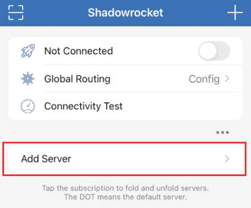 | 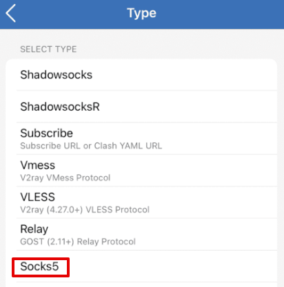 |

左图点 **Add Server／添加节点** ，或右上角 **＋** 。右图选择 **Socks5** 。左图的路由此时仍是 Config，下一节会改为 Proxy。图片来源：[Proxy-Seller 的 iOS 教程](https://proxy-seller.com/blog/how_to_set_up_and_use_a_proxy_in_shadowrocket_for_ios/)。


**图 9｜SOCKS5 字段位置：地址、端口、用户、密码**

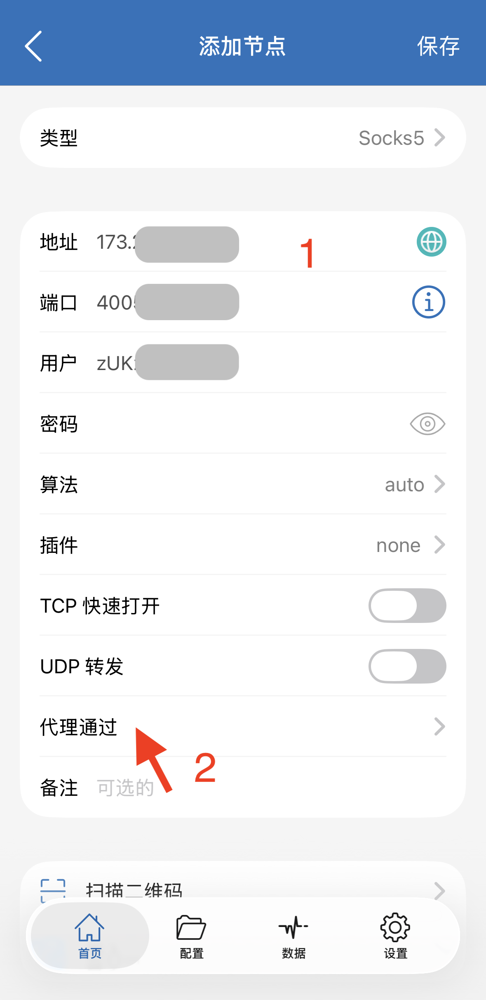

只对照图中红色 1 附近的四项字段和右上角“保存”，填入自己的代理资料。 **红色 2 指向的“代理通过”属于原来源的链式代理步骤，本次基础流程不操作它。** 算法、插件等其余项保持默认。 图片来源：[GetIPProxy 的 Shadowrocket 界面图](https://www.getipproxy.com/guides/clash-chain-proxy/shadowrocket/)。


**完成标志：** 首页能看到保存的节点，重新进入编辑页时，类型、地址和端口与供应商交付一致。字段对应也可参考 [Proxy-Seller 的 iOS 配置图文](https://proxy-seller.com/blog/how_to_set_up_and_use_a_proxy_in_shadowrocket_for_ios/)；它是服务商的一手教程，不是开发者官方手册。

### 4.3 选择路由并连接

为方便第一次检查，本教程先用 **代理模式（Proxy）** ，减少自定义规则带来的判断分支。

1. 在 Shadowrocket 首页打开 **全局路由（Global Routing）** ，选择 **代理（Proxy）** 。
2. 回首页，再确认选中的是刚才保存的节点。
3. 打开顶部连接开关。
4. 首次连接若弹出“允许添加 VPN 配置”，点 **允许（Allow）** ，再按 iPhone 提示验证。
5. 等待 Shadowrocket 显示已连接。此时先检查网络，不急着打开 Facebook 登录。

代理模式会影响这部手机中经过该工具处理的其他联网请求，不只影响 Facebook。个人日常应用不需要使用这条代理时，先结束 Facebook 操作，再关闭连接；下次用 Facebook 前重新检查。

**注意：** 显示 VPN 已连接，只表示手机上的连接已启动，不保证远端代理可用。这里也不能用 Wi-Fi 设置里的“HTTP 代理”代替 SOCKS5 节点。

**图 10–11｜选代理路由，再允许 VPN 配置**

| 图 10：全局路由 | 图 11：首次连接权限 |
| --- | --- |
| 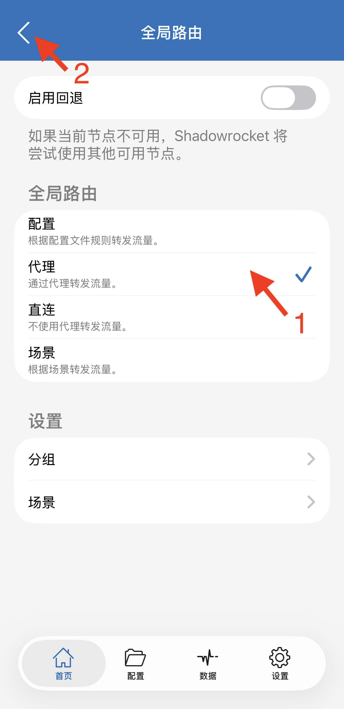 | 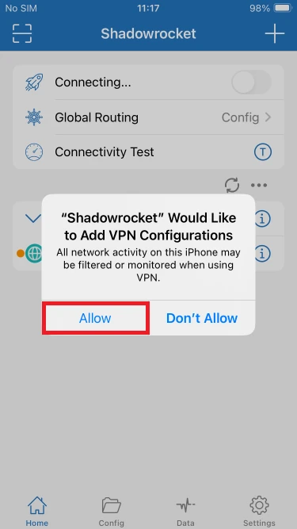 |

左图确认 **“代理”这一行有勾** ，然后返回首页打开连接。右图只在首次连接等需要授权时出现，点 **Allow／允许** ，再完成手机验证。右图背景显示 Config 是旧教程原画面；你的路由按左图选 Proxy。图片来源：[图 10：GetIPProxy](https://www.getipproxy.com/guides/clash-chain-proxy/shadowrocket/)、[图 11：IPRoyal](https://iproyal.com/integrations/how-to-use-iproyal-proxies-with-shadowrocket/)。


### 4.4 检查出口与 Facebook 是否可用

1. 保持 Shadowrocket 已连接，打开 Safari，访问 [Whoer](https://whoer.net/)。
2. 核对出口 IP、地区是否符合购买的代理说明。代理主机是域名或中转地址时，不要求它与出口 IP 一模一样。
3. 若结果明显不对，回 Shadowrocket 检查选中的节点和“全局路由”；仍不对时，先不要登录账号，按 6.4 留下检测结果交供应商核对。
4. 打开 Facebook App，检查登录页能否正常加载。如果网络仍有疑问，将节点名称、检测结果与 App 加载情况一起交给供应商，让其核对实际连接路径；新手不用自行修改高级规则。

**仅在 Safari 检测异常时检查 iCloud 专用代理：** 在 iPhone“设置 → 你的姓名 → iCloud → 专用代理”查看是否开启。它可能影响 Safari 的出口结果，因此 Safari 结果不能单独证明 Facebook App 的路径。需要做临时对照时，可按 [Apple 的操作说明](https://support.apple.com/en-gb/102022)，仅对当前检测网站使用“显示 IP 地址（Show IP Address）”选项；找不到该选项时交管理员协助，不必全局关闭手机的隐私保护功能。

**通过标准：** 代理连接可用、出口符合说明、Facebook App 能加载。只有延迟数字变绿或出现 VPN 图标还不够。

本节基础界面参考 [App Store 产品信息](https://apps.apple.com/us/app/shadowrocket/id932747118)及 [TMPX 服务商的接入说明](https://www.tmpx.io/blog/shadowrocket-ios-setup)。后者是服务商教程，不是 Shadowrocket 开发者手册；其套餐专属参数不能直接套给其他供应商。当前未找到开发者发布的完整手工配置教程。

### 4.5 在 Facebook App 注册或登录

#### A. 还没有 Facebook 账号：自行注册

1. 确认 Shadowrocket 已连接到正确节点，打开 **Facebook App** 。
2. 点击 **创建新账号（Create new account）** ，根据界面选择“开始”。
3. 填写本人实际使用的姓名和真实生日，按提示填写性别等信息；资料 3 中的截图值仅为示例，不照抄。
4. 选择手机号注册；如果想用邮箱，在界面提供该选项时点击 **使用邮箱注册（Sign up with email）** 。
5. 填写能长期接收验证码的手机号或邮箱，设置 Facebook 密码。
6. 阅读当前条款和提示，确认后提交。去短信或邮箱取得验证码，回 Facebook App 完成确认。
7. 头像、联系人同步、通知等后续选项按本人需要设置；可跳过的选项无需为了养号全部打开。

**图 12｜iPhone 注册：邮箱入口、密码和确认提示**

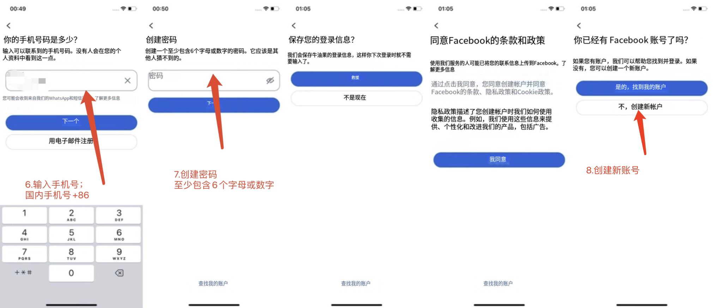

从左往右对照：手机号页面也提供“用电子邮件注册”；随后设置独立密码，并阅读条款。图中的 +86 只适用于中国大陆手机号，密码长度要求以当前页面为准。最后一屏若提示已有账号，已有账号应找回／登录；确实没有账号才继续创建。是否保存登录信息由自己决定。 图片来源：[你提供的资料 3，旧版 App 截图](https://my.feishu.cn/wiki/DgPQwEXEyijPyOkMQYycFi1knud)。


**完成标志：** 进入信息流，能打开自己的个人资料，且注册确认和当前要求的验证已经完成。之后看第 **5.1 节** 。

#### B. 已经有 Facebook 账号：直接登录

1. 先连接并检查 Shadowrocket，再打开 **Facebook App** 。
2. 输入登录邮箱／手机号／用户名和 **Facebook 密码** ，点击 **登录** 。
3. 若出现二次验证，从账号绑定的验证方式取得验证码后输入。
4. 打开个人资料，核对是不是交接的目标账号。
5. 若显示身份确认、锁定或停用，先按第 **6.3 节** 处理，暂不继续养号操作。

**完成标志：** 目标账号已进入，个人资料能打开，当前登录验证已完成。

### 4.6 下次使用和结束使用

**下次开始：** 打开 Shadowrocket → 点选同一份节点 → 连接 → 检查状态 → 打开 Facebook App → 核对账号与通知。

**结束使用：** 先完成 Facebook 中的操作，关闭 Facebook App；需要停止使用代理时，再关闭 Shadowrocket 连接。若要确保 App 已退出前台和后台，可从 iPhone 的 App 切换界面上滑关闭。不要在 Facebook 正进行验证时来回切换连接。

首次配置后，正常重开一次 App，确认知道怎样回到正确账号即可，不需要为了测试每天退出再登录。

## 5. 登录后的检查与日常养号

这里把“养号”作为团队对账号初期正常使用的称呼。 **没有“刷满几天就安全”或“点赞多少次就解锁”的保证。** 先确保账号可用、本人能够恢复访问，再进行自然的浏览与互动。

### 5.1 首次登录后，检查这四项

**① 是不是正确账号**

打开个人资料，核对姓名、头像和账号信息。团队交接账号时，核对内部编号，不只靠相似头像识别。

**② 有没有未处理提示**

先看页面顶部和通知，再从头像／菜单进入 **帮助与支持（Help & support）** ，查找 **账号状态（Account Status）** 、支持收件箱或当前提供的支持入口。记录提示原文；不同版本可能显示新的“支持”页面。

找不到入口时，在 Facebook 设置或帮助中心搜索“账号状态”。“没有看到提示”只代表当前没有可见提示，不等于以后不会验证或限制。

**③ 恢复方式是否可用**

从 **设置和隐私 → 设置 → 账户中心（Accounts Center）** 查看个人详细信息／联系方式，确认绑定邮箱或手机号由谁控制，能否使用。准备修改时，先确保新联系方式能接收确认信息，再按平台提示完成替换；不要先删掉唯一可用的恢复方式。

**④ 密码和二次验证是否由自己掌握**

在 **账户中心 → 密码和安全（Password and security）** 检查密码、登录位置和双重验证（Two-factor authentication）。发现无法解释的登录，按第 6 节处理。

建议开启一种自己能掌握的双重验证方式；尚未开启时在检查记录中写明“未开启”，不要记成“已验证可用”。使用验证器方式时，把 Facebook 显示的二维码或设置密钥添加到本人使用的验证器，再将生成的验证码填回 Facebook 完成绑定。同一部手机无法扫描自己屏幕时，使用验证器的“输入设置密钥／手动输入”方式。恢复码单独保管，不放进共享教程，也不把密钥贴到陌生在线验证码网站。

有必要更新交接密码时，先确认恢复方式能用，再按页面流程修改；如果平台暂不允许修改，保留提示并交负责人处理，不反复提交。

**图 13｜在哪里找账户中心、个人信息和密码安全**

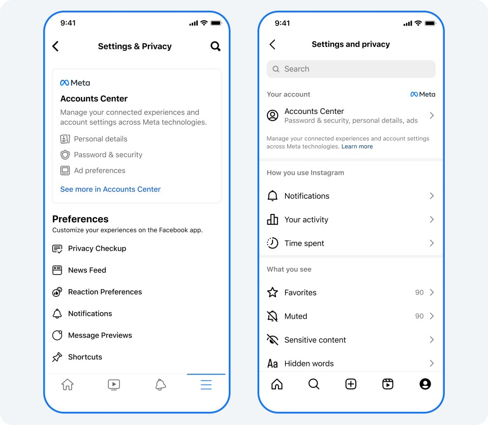

**左图是 iPhone Facebook App 的旧版设置界面；Mac 网页端按正文路径查找同名设置，按钮位置不同。只看左图即可。** Accounts Center 是“账户中心”；Personal details 是“个人详细信息”；Password & security 是“密码和安全”。右边是 Instagram 对照图，不是本教程操作对象。这是 Meta 官方发布的旧版界面。 图片来源：[Meta 官方账户中心说明](https://about.fb.com/news/2023/10/manage-your-information-across-apps/)。

**如果名称变了：** Meta 于 2026 年 4 月宣布逐步将 Accounts Center 更新为 Meta Account。若你看到“Meta 账户”，从当前入口查找联系方式、密码和双重验证即可；找不到时使用设置内搜索。[Meta 官方更新说明](https://about.fb.com/news/2026/04/meta-account/)


### 5.2 日常打开后，按这个顺序用

1. **先检查连接。** Mac 打开原来的 AdsPower 环境；iPhone 连接原来的 Shadowrocket 节点。代理被修改、网络切换或出现异常后，重新检查出口。
2. **再看账号通知。** 有验证码、身份确认或限制提示，先处理提示。
3. **正常浏览感兴趣的内容。** 可搜索与短剧相关的题材，观看、收藏有参考价值的内容，熟悉信息流和搜索功能。
4. **有真实需要再互动。** 喜欢才点赞，有内容可说才评论；添加认识的人、关注确实想持续看的主页。无需为了完成次数而连续操作。
5. **资料有缺项时再完善。** 头像、简介和联系方式使用真实且有权使用的信息；一次改动后检查是否保存成功。
6. **结束前记下异常。** 无异常时正常关闭；有异常时留下提示、时间和已做过的处理，方便接手人继续排查。

每次使用多久、一天打开几次，由实际工作需要决定。本版不沿用“每天必须刷若干分钟”“固定点赞几次”的硬指标，也不使用自动点赞、批量加好友或群发私信来养号。

**这阶段完成的标准：** 能从固定入口回到正确账号，浏览功能可用，恢复方式可用，当前要求的验证已完成；已开启的二次验证也能使用。锁定、身份核验未完成、无法恢复访问、无法解释的登录，以及当前需要使用的功能仍受限，都算未解决的关键异常。若浏览正常但评论受限，可继续查看信息，但先不继续尝试评论，记录限制并按提示处理。是否完成不按天数判断。

### 5.3 一张简短检查单

- [ ] 我使用的是正确环境／节点，账号身份也正确。
- [ ] 代理可连接；必要时已核对出口。
- [ ] 已查看通知和账号状态，没有遗漏待处理验证。
- [ ] 绑定邮箱／手机号可用；已开启的二次验证可用，未开启则已明确记录。
- [ ] 如有异常，已记录原文并停止重复尝试。

## 6. 出问题时，先分清是哪一层

**软件打不开 → 软件问题；代理连不上 → 网络问题；Facebook 提示锁定／验证 → 账号问题。** 先读清楚错误信息，避免用改密码解决网络问题，或用换 IP 解决身份核验。

### 6.1 代理连接失败

按顺序检查，每改一项再测试一次：

1. **本地网络：** 先结束 Facebook 操作。Mac 在 AdsPower 环境外用普通浏览器打开一个平时可用的网站；iPhone 暂停 Shadowrocket 后做同样检查。若普通联网也失败，先修复 Wi-Fi／移动网络。检查完再恢复原代理，暂不登录 Facebook。
2. **类型：** 是否选了 SOCKS5，而不是 HTTP、Shadowsocks 或 Socks5 Over TLS。
3. **四项资料：** 地址、端口、用户名、密码是否填反、多了空格或已过期。
4. **供应商要求：** 套餐是否到期、是否要求 IP 白名单、是否允许当前设备，当前网络能否直接连接代理。
5. **连接条件：** 若供应商要求前置网络，而当前没有满足，先让供应商或管理员完成该条件。只买到一个代理地址，不代表所有本地网络都能直接连上。

Mac 可按 [AdsPower 官方排查步骤](https://help.adspower.net/docs/ru-he-pai-cha-dai-li-shi-bai-wen-ti-gVLB)，从 **个人设置 → 本地设置 → 网络检测** 判断本地网络与系统代理。只有确实已有相应系统代理、且官方检测条件满足时，才按教程使用“使用系统代理连接代理”。

iPhone 的基础步骤以“本机能直接连到该 SOCKS5 端点”为前提。若端点需要额外中转，请供应商提供适用于 iPhone 的完整连接说明；本版不能仅凭五项资料替你推定中转设置。

整轮检查后仍失败，就停止继续改设置，按 6.4 联系订单里的代理供应商客服。Facebook 账号／验证问题找交付账号的人；自行注册账号无法恢复时使用官方恢复入口，并告知团队负责人。不要把密码发到公开群里求助。

### 6.2 代理显示成功，但 Facebook 打不开

| 看到什么 | 下一步 |
| --- | --- |
| 所有网页都打不开 | 回 6.1 检查代理、本地网络和有效期 |
| 检测网站能开，只有 Facebook 不开 | 检查代理套餐是否允许访问 Facebook，尝试重新打开页面／App，向供应商确认服务状态 |
| Mac 检测出口不对 | 确认检测在 AdsPower 环境内进行，核对该环境保存的代理 |
| iPhone 显示已连接，出口不对 | 核对选中节点、全局路由和其他网络功能；必要时查看请求记录 |
| 浏览器可用，Facebook App 不加载 | 检查 App 更新及实际请求路径；重新连接后重开 App，仍失败则把情况交供应商核对，避免乱改 UDP／DNS 等高级项 |

打不开页面本身，不能直接认定账号被封。

### 6.3 页面能开，但账号登录不了

| 提示／现象 | 怎么处理 |
| --- | --- |
| 注册时提示暂时无法创建账号 | 保存完整提示，检查是否已注册成功或是否需要补充验证；有等待说明时按说明等待。仍失败则记录并交负责人核对，不连续注册、不反复换环境 |
| 密码错误 | 先核对账号标识、大小写、空格及是否误用了代理密码；仍失败时用 Facebook 的“忘记密码”或找交接人核对 |
| 收不到邮件／短信验证码 | 核对邮箱、区号和手机号，检查垃圾邮件与短信拦截；按页面等待后再请求，优先用最新验证码 |
| 二次验证码无效 | 确认验证器里选对账号，手机日期时间设为自动，等下一组代码再输入；仍无效时用已保存的恢复方式 |
| 需要确认身份／视频自拍／证件 | 只在 Facebook 自己打开的流程中按要求提交真实材料；无法完成时记录提示交负责人处理，不假设“养几天就能跳过” |
| 暂时限制某个功能 | 停止重复点击该功能，查看账号状态与当前给出的限制／复查说明 |
| 账号锁定、暂停或停用 | 保存提示和可见期限，使用界面提供的恢复或申诉入口；不承诺固定几小时恢复 |
| 出现本人无法解释的登录或密码变化 | 从官方入口核实，保护邮箱、更新密码并处理陌生会话；必要时使用 [Facebook 被盗账号处理入口](https://www.facebook.com/hacked) |

### 6.4 向负责人或供应商反馈，发这几项就够

```text
设备：Mac / iPhone
环境或节点编号：
出现时间：
卡在哪一步：
提示原文：
代理检测结果：成功 / 失败
Facebook 登录页能否打开：
已经尝试的处理：
```

附上遮住账号敏感信息的截图。反馈中不粘贴密码、验证码、恢复码或完整代理凭据。

## 7. 来源与核对说明

### 原始资料

- [资料 1：Facebook 账号运营标准化 SOP](https://inbeidou.feishu.cn/wiki/Z30HwDQkBik9d6kZjWsc1Ny9nub)：账号获取、初期使用与检查事项。
- [资料 2：七星 Facebook 海外短剧推广教程](https://my.feishu.cn/wiki/K9awwp1hKiZz9okeaUgclqRXnXb)：工具入口和网络使用经验。
- [资料 3：七星 苹果手机从设置到 Facebook 账号注册](https://my.feishu.cn/wiki/DgPQwEXEyijPyOkMQYycFi1knud)：iPhone 注册流程参考；本次查看了注册姓名、生日等步骤的截图。
- [资料 5：AdsPower 使用教程](https://hcnfyz3xrv0y.feishu.cn/wiki/WHUawHFXZixXDEk8T3ZcATOqnte)：浏览器环境与 SOCKS5 配置信息结构。原文含敏感样例，本版未复制其具体值。
- [关联资源表：七星海外短剧&小说推广资源汇总表单](https://my.feishu.cn/wiki/MQgmwBoDti3Lt2k4yE6cEUfsnxb)：已读取“海外短剧合集”和“海外小说合集”两张工作表，核对版本为 revision 32。内容为素材与推广资源，未列出 Facebook 买号商家。

资料 4 的 AiToEarn 买号入口按本版范围排除。原资料中“刷机为必需”“检测评分达到某值就安全”“固定刷视频或绑定某工具能加权重”等说法，未作为本教程的执行条件。

### 软件与平台参考

配图按来源原样引用，未重新绘制软件界面。图 5、6 是本次打开 Facebook 公共页面所得截图；其他图片来自各图注明的官方教程、服务商教程或你提供的资料。服务商图片仅用于说明界面，不增加买号或代理推荐。

- AdsPower：[下载](https://www.adspower.com/download)、[安装](https://www.adspower.com/tc/blog/adspower-browser-install-guide)、[创建环境](https://help.adspower.net/docs/j0c1p3)、[详细环境设置](https://help.adspower.net/docs/PpLudA/adspower)、[代理配置](https://help.adspower.net/docs/k1a68p)、[排查连接失败](https://help.adspower.net/docs/ru-he-pai-cha-dai-li-shi-bai-wen-ti-gVLB)。这些是 AdsPower 官方资料。
- Shadowrocket：[App Store 正版页面](https://apps.apple.com/us/app/shadowrocket/id932747118)、[开发者网站](https://shadowlaunch.com/)。手工填写字段参考 [Proxy-Seller 的 iOS 图文](https://proxy-seller.com/blog/how_to_set_up_and_use_a_proxy_in_shadowrocket_for_ios/)，连接与路由另参考 [TMPX 接入说明](https://www.tmpx.io/blog/shadowrocket-ios-setup)，仅作为基础步骤参考，不代表推荐购买该服务商。
- Facebook：[App Store](https://apps.apple.com/us/app/facebook/id284882215)、[注册帮助](https://www.facebook.com/help/188157731232424/)、[账号状态帮助](https://www.facebook.com/help/1392616391875085/)、[账号安全](https://www.facebook.com/help/235353253505947/)、[账户中心说明](https://www.facebook.com/help/943858526073065)、[双重验证相关入口](https://www.facebook.com/help/1167409720358611)、[新版账号支持说明](https://about.fb.com/news/2025/12/making-it-easier-to-access-account-support-on-facebook-and-instagram/)。

**核对边界：** 本版依据已读取正文、指定注册截图和公开帮助整理，本次仅打开 Facebook 公共登录页与空白注册表单截图，没有实际登录你们的 Facebook 账号，也没有使用真实代理在 Mac／iPhone 上完成实测。部分 Meta 帮助页本次读取时跳转登录或受到访问限制，因此保留官方入口供操作时查阅；注册与检查步骤中的按钮应以实际 App／网页为准。
