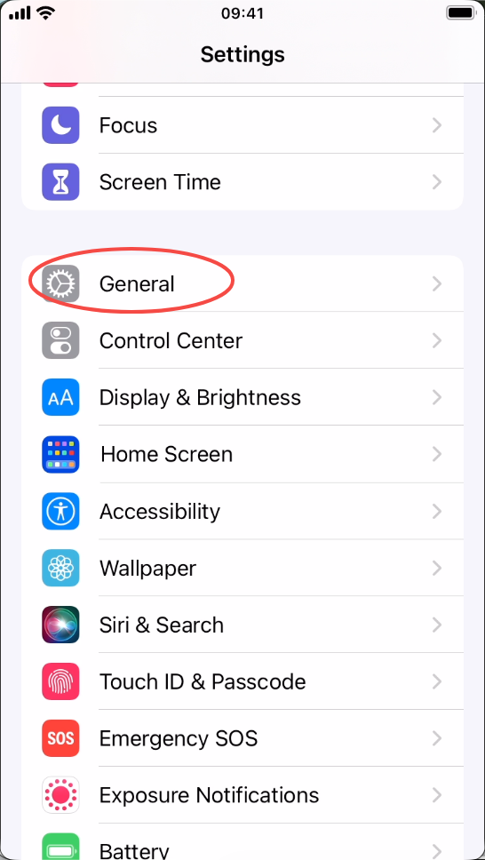
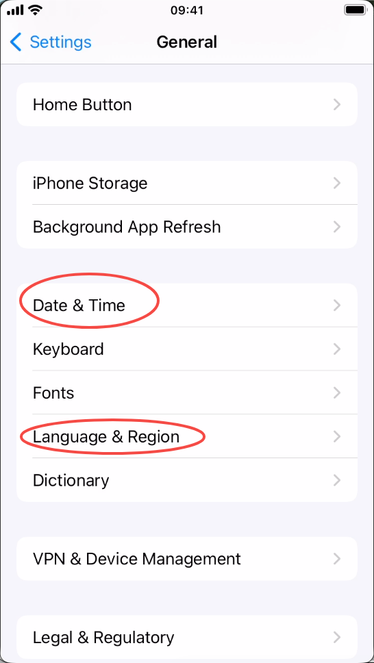
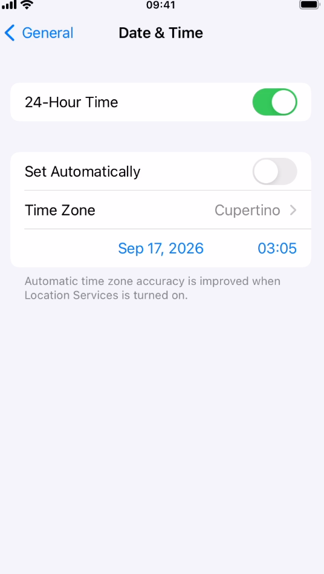
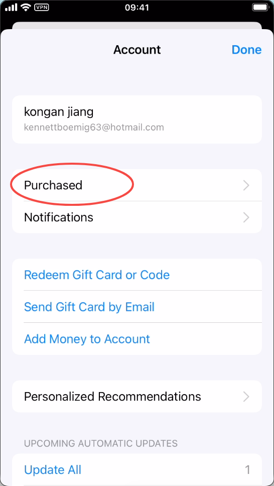
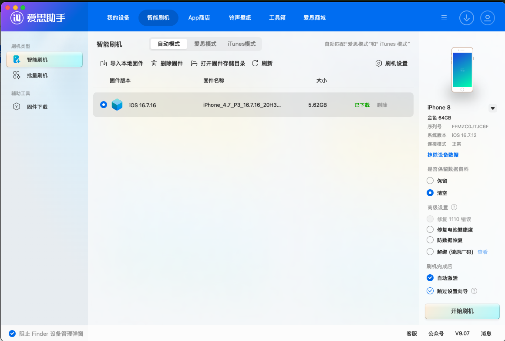
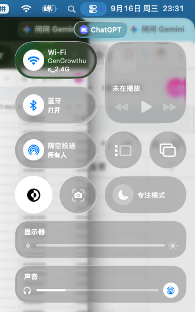

# 短剧发行新手操作手册

> 大纲版，具体做法后续逐项补充。还没确定的地方先留空，不作为正式操作要求。

这份手册给第一次接触短剧发行的同事用。从准备手机和账号开始，到发出视频、记录结果，按实际做事的顺序往下看。

## 1. 开始前，先知道我们在做什么

### 1.1 我们发布什么，收益从哪里来

我们发布的是短剧二创内容，常见的做法有：

- 普通切片：从完整剧集中剪出精彩片段。
- 影视感剪辑：以俊男靓女、画面氛围等内容为主。
- 音乐卡点：跟着音乐节奏安排画面切换。

观众看完视频后，可以通过 Caption 里的分销链接去看完整的剧，也可以在对应平台输入我们提供的代码。代码一般是数字，或者数字和字母的组合。观众通过我们的链接或代码进入平台并完成付费后，我们可以获得分销收益。

### 1.2 新同事先找谁分配账号

新同事找彭满分配账号。彭满会根据每个人的能力和当前工作安排，决定分配哪些账号和手机。

手机和账号会处在不同的准备阶段。接手前先确认目前进行到哪一步：

1. 纯新机
2. 已修改手机的时间、语言和地区
3. 已登录 App Store
4. 已下载 TikTok 等需要的软件
5. 已购买并登录 TikTok 账号
6. 正在养号
7. 已完成养号，但还没有开始发布
8. 已经开始发布

接手时不要只看手机在不在，还要确认上面的准备步骤做到哪里了。

### 1.3 日常会用到的工具

#### Social 机器人

在飞书里搜索“Social 机器人”。它可以用于短剧剪辑、发布和上传。如果机器人提示没有权限，优先联系彪哥王志彪。

#### GPT、Codex 或其他 Agent 工具

可以使用 GPT/Codex 的 Plus 账号，也可以使用其他 Agent 账号。还可以购买 API，但目前不推荐，因为费用较高。

GPT 和 Codex 以外的工具怎样使用短剧剪辑 Skill，等彭满研究后再补充。

#### 剪映或 CapCut

如果想自己做更细的调整，或者临时想剪一条质量更高的视频，可以使用剪映或 CapCut。

以上工具如果用于办公，可以申请报销。具体要求可以问彭满或王玲玲姐。

### 1.4 需要开通的分发平台

#### ReelShort Boost

- 注册入口：见文末“常用链接汇总”。
- 可以自行注册，优先使用企业邮箱。
- 邀请码：`MUcUGHS4uxLr`

#### MoboReels / Mobo Boost

Mobo Boost 是分发平台，同时也做联盟平台。团队已经建立了对接群，联系人是林老师。目前只对接媒体分发，暂无 API。

- 注册入口：见文末“常用链接汇总”。
- 使用公司邮箱注册。
- 邀请码：`U384068`

#### 鹊娱

鹊娱账号需要找王玲玲姐领取。

- 登录入口：见文末“常用链接汇总”。
- 昵称可以自定义。
- 账号使用 8 至 12 位纯数字。
- 第一次用原始密码登录后，系统会提示修改密码。

#### 七星剧浪（北斗智影）

可以自行注册。

- 邀请链接：见文末“常用链接汇总”。
- 邀请码：`E7FX2`

### 1.5 日常会用到的表格

#### 社媒账号资产表

链接见文末“常用链接汇总”。

购买账号和 IP，或者查找账号资料时，会用到这张表。

#### 短剧发行管理表

链接见文末“常用链接汇总”。

平时选完剧、安排发布和发布完成后，都要在这张表里填写对应的内容。具体填写方法会放在后面的操作步骤里。

## 2. 买手机：缺手机找玲姐，拿到后做好登记

缺手机时，直接找玲姐。手机型号、购买渠道、验机和退换等事情都由玲姐统一负责，其他同事不需要自行处理。

### 2.1 在设备表登记新手机

拿到新手机后，需要马上完成下面的登记：

1. 打开飞书里的“社媒账号资产表”，链接见文末。
2. 进入“设备表”，新增这台手机的信息。
3. 先看已有手机排到多少号，再按顺序往后编号。格式照着前面的记录填写。例如前一台是 `Phone-25`、`手机25`，新手机就填 `Phone-26`、`手机26`。
4. 手机型号参照前面的设备记录填写。
5. 状态默认选择“使用中”。

“关联 TikTok”等后面的字段会在下一节说明，这里先不用展开。

待补：设备表操作截图。

### 2.2 做好新手机的基础设置

1. 先让手机连接 `gengrowthus` Wi-Fi，Wi-Fi 密码找彭满领取。
2. 打开 iPhone 的“设置（Settings）”。
3. 找到“通用（General）”并点进去。



4. 在“通用（General）”里找到“日期与时间（Date & Time）”和“语言与地区（Language & Region）”。



5. 进入“日期与时间（Date & Time）”，关闭“自动设置（Set Automatically）”。
6. 把时区和时间改成账号对应的美国地区。



7. 回到“语言与地区（Language & Region）”，把手机语言和地区改成美国相关设置。

### 2.3 登录 App Store 并下载小火箭

完成时间、语言和地区设置后，登录 App Store 账号：

1. 打开 App Store。
2. 点击右上角蓝色的人像图标，进入账号页面。
3. 使用下面的账号登录：

   - 账号：`KennettBoemig63@hotmail.com`
   - 密码：找彭满领取

4. 登录成功后，在账号页面点击“Purchased”。平时常用的软件可以从这里找到并重新下载。



5. 从 App Store 下载 Shadowrocket，也就是“小火箭”。如果以前下载过，也可以在“Purchased”里找到。
6. 下载完成后，找彭满领取小火箭二维码。
7. 在小火箭中扫描二维码，然后点击“Connect”进行连接。

## 3. 买 IP：先确认地区，再选择购买方式

### 3.1 IP 是做什么的

我们把每台手机当成一个单独的用户。不同用户的网络环境不同，所以每台手机使用的 IP 也不一样。

### 3.2 购买前要确认什么

先确认账号准备做哪个地区。默认使用美国地区，因为美国 IP 的数量较多，价格也比较便宜。

购买前确认下面四项：

- 使用地区
- 需要的数量
- 有效期
- 费用

购买 IP 的费用可以报销。

### 3.3 购买方式一：找彭满购买 VPN

彭满手上有一个购买 VPN 的微信群。这里卖的是“梯子”，也就是 VPN。连接后可以直接访问外网。

- 优点：可以连接 `JINGE` Wi-Fi 使用。
- 缺点：稳定性相对差一些。

需要购买时，直接联系彭满。

### 3.4 购买方式二：购买静态住宅 IP

购买入口见文末“常用链接汇总”。

- 账号：`admin@gengrowth.ai`
- 密码：找彭满领取

这里购买的是静态住宅 IP，也就是一个固定的海外 IP。价格会贵一些，但相对稳定。

使用前需要注意：

- 必须先连接外网，静态住宅 IP 才能使用。
- 购买这里的 IP 后，手机只能连接 `gengrowthus` Wi-Fi 使用。

### 3.5 购买方式三：其他网络平台

也可以从其他 IP 平台购买，包括但不限于：

- 9HTTP
- 711Proxy
- 其他可以在网上找到的 IP 平台

这些平台目前还没有验证过，也没有实际合作经验。价格可能会比 TopIP 便宜一些，但稳定性和实际使用效果还不确定。现阶段只能作为备选，不要把它们当成已经验证过的平台。

### 3.6 买到 IP 后怎么连接

购买完成后，商家一般会提供一个二维码。连接步骤如下：

1. 打开手机上的 Shadowrocket，也就是“小火箭”。
2. 扫描商家提供的二维码。
3. 在小火箭中完成连接。
4. 把商家发来的 IP 信息填入“社媒账号资产表”里的“IP 表”，表格链接见文末。

### 3.7 平时注意 VPN 有没有断开

> 注意：使用手机时，要经常看一下屏幕左上角。Wi-Fi 图标右边应该显示“VPN”。如果没有显示，VPN 可能已经断开。先停止操作并重新检查连接，否则可能导致 TikTok 账号被封。

待补：IP 表需要填写的具体字段、没有二维码时的连接方法和续费方式。

## 4. 买号和接号：确认这个账号可以交给你使用

购买账号前，先确定账号要做哪个国家或地区。账号地区一般要和这台手机使用的 IP 地区对应。

### 4.1 买号时优先选择零粉号

买号时尽量选择没有粉丝的账号。根据目前的测试，买来的带粉账号普遍会在两天左右掉光粉丝，所以没有必要为了原有粉丝多花钱。

### 4.2 账号来源一：找彭满购买

找彭满要购买账号的微信群。群里可以买到多个国家和地区的账号，购买时说清楚需要的地区和数量。

### 4.3 账号来源二：第三方网站

目前可以参考的网站有：

- HUMKT
- TikTokHao
- 其他可以买到对应地区账号的网站

> 注意：在第三方网站购买时，一定要选择剩余库存较多的商品。库存太少时，有可能遇到账号已经被其他人买走的情况。

### 4.4 账号来源三：自己注册

可以先注册 Outlook 邮箱，再用邮箱注册 TikTok 账号。这种方式彭满还没有研究完成，目前先作为备选，不要当作正式流程。

### 4.5 需要买粉时怎么做

买粉入口见文末“常用链接汇总”。

- 充值方式找彭满。
- 尽量选择页面上价格为 `0.021`、`0.043` 或 `0.045` 的项目。
- 不要选择价格为 `0.01` 的项目。

买粉的目的是把账号补到 1,000+ 粉丝，让个人账号可以在 TikTok 主页添加网站链接。TikTok 官方目前的说明是，个人账号至少有 1,000 名粉丝后可以添加网站链接，但这个功能并非所有地区都开放。具体以账号里实际显示的功能为准。

TikTok 官方说明链接见文末。

### 4.6 拿到账号后做好登记

拿到账号后，在“社媒账号资产表”里新增记录，把账号信息填进去。表格链接见文末。

待补：账号表需要填写的具体字段、拿到账号后的检查方法，以及怎样关联对应的手机和 IP。

## 5. 养号和账号准备：正式发视频前做什么

### 5.1 安装并登录 TikTok

1. 确认小火箭已经连接，手机左上角显示“VPN”。
2. 从 App Store 下载 TikTok 和 TikTok Studio。以前下载过的软件可以从“Purchased”里找。
3. 找彭满领取分配给这台手机的 TikTok 账号，然后登录。

### 5.2 养号 3 天

登录后先养号 3 天。每天进行 2 至 3 次，每次大约 15 至 30 分钟。

每次可以这样操作：

1. 先在“For You”推荐页刷大约 10 分钟。喜欢的内容多看一会儿，不喜欢的直接划走，偶尔点赞。
2. 在“Search”中搜索 `drama`、`aidrama`、`dramaseries` 等关键词。
3. 也可以先去 ReelShort 或 DramaBox 找到感兴趣的短剧，再去 TikTok 搜索剧名。网站链接见文末。
4. 看到短剧内容后，可以正常观看、点赞和评论。评论可以使用 `next part plz!`、`nice!`，也可以发表情。

### 5.3 什么情况下可以开始发布

养号满 3 天后，检查下面两点：

- “For You”推荐页刷到的内容基本都是短剧。
- 账号可以正常点赞和评论，没有功能受限。

两点都正常，就可以开始发布短剧内容。

### 5.4 发布 3 天后判断要不要继续

先连续发布 3 天短剧内容进行测试。

- 如果这 3 天发布的视频平均播放量在 200 以上，可以继续发布。
- 如果视频都只有几十播放，先告诉彭满，再一起判断这个账号是否弃用。

这里的播放量是团队目前用于测试账号的判断标准，不是 TikTok 的官方规定。

### 5.5 账号出现异常怎么办

如果出现登录异常、点赞评论受限或其他功能问题，先告诉彭满，再联系买号客服询问原因，最后判断这个账号是否弃用。

### 5.6 账号封禁后重新刷机

如果账号已经确认封禁，需要清空手机重新使用，可以在电脑上安装“爱思助手”进行刷机。

> 注意：刷机会清空手机里的全部资料。开始前先确认这台手机上没有需要保留的内容，也不要选错设备。

操作步骤：

1. 在电脑上下载并安装爱思助手。
2. 把需要刷机的 iPhone 连接到电脑。
3. 打开爱思助手，进入“智能刷机”。
4. 选择需要使用的固件。
5. 在“是否保留数据资料”中选择“清空”。
6. 勾选“自动激活”和“跳过设置向导”。
7. 确认设备和选项没有选错，然后点击“开始刷机”。



刷机完成后，把这台手机当作新手机，重新完成网络、时间、语言、地区、App Store、小火箭、IP 和新账号登录等流程。

待补：账号异常情况的截图和买号客服的联系方式。

## 6. 选剧：给这个账号找合适的内容

选剧前先确认这个账号面向什么观众、使用什么语言，以及主要对应哪个分发平台。

### 6.1 常用的选剧入口

#### ReelShort Boost

- ReelShort Boost 登录入口
- ReelShort Boost 资源广场
- RS 分销剧单

可以从首页的“英语自制剧”“当周上新”“新手必推”等栏目选剧，也可以在资源广场按上线时间从近到远查看新剧。

#### MoboReels / Mobo Boost

- Mobo Boost 登录或注册入口
- Mobo Boost 使用指南

#### 鹊娱

- 鹊娱登录入口
- 各短剧平台的推广资源和发布规范
- 鹊娱分销平台操作手册

#### 七星剧浪（北斗智影）

- 七星剧浪登录或注册入口
- 七星海外短剧推广资料

### 6.2 使用彪哥的选剧平台

彪哥选剧平台链接见文末。

选剧平台会参考短剧的新鲜度、热门程度和分发收益等信息，可以先从平台推荐的剧里挑选。

目前可用的账号有：`wzb`、`mby`、`gx`、`wl`、`pm`、`zkf`。

共享 SOP 不记录账号密码。需要密码、注册新账号或增加账号时，联系彪哥王志彪或彭满。

### 6.3 目前怎么选，哪些还需要继续观察

现阶段可以从下面几个地方开始找剧：

- 短剧官网的首页和排行榜。
- 分发平台的推荐、新手必推和当周上新。
- 彪哥选剧平台的推荐结果。

到底应该优先选新剧还是热剧，以及哪些数据最值得看，目前还没有固定答案，需要继续测试和记录。每次选完剧后，把剧名、账号、选剧来源和后续发布结果记进短剧发行管理表，方便以后回头比较。

待沉淀：新剧和热剧各自适合什么账号、选剧时重点看哪些数据，以及不同分发平台的实际表现。

## 7. 准备视频：从下载素材到可以发布

### 7.1 下载短剧素材

选好剧后，到对应的分发平台下载素材。常用入口如下：

- ReelShort Boost
- RS 分销剧单
- MoboReels / Mobo Boost
- 鹊娱
- 七星剧浪（北斗智影）

### 7.2 先选择剪辑方式

目前有两种剪辑方式，可以根据时间、数量和想要的效果来选。

#### 剪辑方式一：传统派，用剪映手动剪辑

把短剧素材导入剪映或 CapCut，自己挑选片段、调整顺序、处理字幕和声音，再导出视频。这种方法适合想自己控制每一个细节，或者只需要精细处理少量视频的时候。

#### 剪辑方式二：革新派，使用彭满的 Skill 剪辑

先把所有需要剪辑的短剧下载到电脑本地，可以一次准备一部，也可以准备多部。然后把每部剧的本地路径发给 GPT，并说明每部剧分别需要剪多少个片段。

例如，你可以一次告诉 GPT：A 剧剪 3 条，B 剧剪 6 条。GPT 会按照你给出的数量，分别输出对应数量的视频。

使用这种方式前，需要先安装短剧剪辑 Skill 和相关依赖。具体安装方法见第 7.5 节。

### 7.3 基本剪辑要求

#### 画面和格式

- 分辨率使用 1080P 或以上。
- 帧率跟原素材保持一致，常见的是 30fps 或 60fps。
- 以 9:16 竖屏为主。
- 输出 MP4、MOV 等常用格式。

#### 声音

- 对话要听得清楚。
- 背景音乐和音效不能盖过人声。
- 音量不要忽大忽小。

#### 节奏和时长

- 前 3 秒尽量放冲突最强、最能吸引人继续看的画面。
- 整体时长以 90 至 150 秒为参考。
- 删掉太长的过渡和日常情节，保留起因、冲突和冲突升级。
- 结尾停在观众想继续看的地方，或者快速放出后续的精彩画面。

#### 做二次剪辑

不要直接把原片完整搬运。可以重新调整片段顺序，并根据需要增加贴纸、边框、画中画、镜像、滤镜、颜色调整或画面缩放。一般可以使用 3 集左右的内容进行剪辑。

### 7.4 Caption、推广链接和推广口令

Caption 里一定要带上这部剧的资源推广口令，也就是观众在短剧 App 中搜索的代码。优先同时使用资源推广链接和资源推广口令。

资源推广链接可以直接放在 Caption 里。千粉账号也可以在 TikTok 主页放 Linktree 链接，一个 Linktree 里可以放多部剧的入口。

Caption 可以参考下面的格式：

```text
Part [集数] | [剧名]

[用一句话写清这一段最吸引人的剧情]

Watch the full episode: [资源推广链接]
Download [App 名称] and search [资源推广口令]

#[相关标签]
```

Hashtag 可以让 AI 根据剧名和剧情生成，数量控制在 5 个以内。

发布前再检查一次：推广链接、推广口令、App 名称和剧名必须互相对应。

### 7.5 使用 GPT Skill 剪辑前要准备什么

使用 GPT Skill 前，需要准备：

1. 一个可以使用 AI Agent 的账号，例如 GPT 或 Codex。
2. 短剧剪辑 Skill。
3. Skill 需要的相关依赖。

Skill 和依赖有两种安装方法。

#### 方法一：从 Obsidian 仓库查找

让 AI 在 Obsidian 的 `gengrowth-ops` 仓库中，查找名称带有 `shortdrama` 的 Skill，并安装到电脑本地。可以直接把下面这段话发给 AI：

```text
请帮我找到 gengrowth-ops 里面名称带有 shortdrama 的 Skill，安装到我的电脑本地，并告诉我需要安装哪些依赖，以及这些 Skill 分别怎么使用。
```

#### 方法二：从 GitHub 下载

1. 找彭满领取 GitHub 链接和访问权限。
2. 把链接发给 AI Agent，让它下载仓库里的完整内容。
3. 让 AI 检查并安装 Skill 需要的依赖。

GitHub 地址、权限开通和安装中的问题，具体问彭满。

### 7.6 怎么让 GPT Skill 开始剪辑

1. 把下载好的短剧放到电脑本地，例如“影片（Movies）”文件夹。不同的剧最好分别放在不同文件夹里。
2. 把每部剧的本地路径和剧名告诉 AI。一次可以提供多部剧。
3. 分别说明每部剧需要剪多少条视频，以及每条视频大概多长。
4. 如果需要剪映或 CapCut 可继续修改的工程文件，要在任务里明确说出来。
5. 如果没有提出工程文件要求，默认输出普通视频文件。

可以参考下面的说法：

```text
请使用短剧剪辑 Skill 处理下面这些短剧：

1. 《[剧名 A]》，本地路径：[文件夹路径 A]，剪 [数量 A] 条。
2. 《[剧名 B]》，本地路径：[文件夹路径 B]，剪 [数量 B] 条。

每条视频控制在 [时长范围]。
请同时生成可以继续编辑的剪映或 CapCut 工程文件。
```

## 8. 发布视频：发到正确的账号，再把记录补齐

### 8.1 发布前先检查素材

一部剧一般会准备 3 条或 6 条视频。发送到手机前，先把每条视频从头到尾看一遍，检查是否有色情、暴力等可能无法过审的内容。

确认视频没有问题后，再准备好下面这些东西：

- 视频文件
- 短剧封面
- Caption，也就是视频简介
- Hashtag，也就是视频标签

检查时注意，同一部剧的视频、封面、Caption 和 Hashtag 不要混到其他剧里。

### 8.2 把素材发送到手机

目前可以用隔空投送或 LocalSend。选择其中一种就可以。

#### 方法一：隔空投送

1. 电脑和手机分别连接 JINGE 或 gengrowth Wi-Fi。两个设备不需要连接同一个 Wi-Fi。
2. 打开电脑的隔空投送。
3. 在手机上依次打开“设置” → “通用（General）” → “隔空投送（AirDrop）”。
4. 选择“所有人，限时 10 分钟（Everyone for 10 Minutes）”。
5. 在电脑上选中需要发送的视频和图片，点击右键，选择“共享” → “隔空投送”。
6. 在弹出的设备列表中找到对应的 iPhone，点击发送。
7. Caption 和 Hashtag 先复制到备忘录里，之后在手机上打开使用。



图中手机已连接 GenGrowth Wi-Fi，隔空投送已设为“所有人”。

发送前看清设备名称，避免把素材发到别人的手机。发送完成后，打开手机相册和备忘录，确认视频、封面、Caption 和 Hashtag 都已收到。

#### 方法二：LocalSend

1. 电脑和手机都安装并打开 LocalSend。
2. 先查看电脑和手机各自的设备名称，记住要接收素材的手机叫什么。
3. 电脑和手机必须连接同一个 Wi-Fi。可以同时连接 JINGE，也可以同时连接 gengrowth。
4. Wi-Fi 名称后面有没有 5G 不影响，重点是两个设备要连接同一个网络。
5. 在电脑的 LocalSend 页面找到对应的手机名称。
6. 把视频和封面拖进 LocalSend 的发送界面。
7. Caption 和 Hashtag 可以直接复制。在 LocalSend 里点击“添加” → “剪贴板”，再发送到手机。
8. 手机上接收完成后，检查文件和文字是否齐全。

### 8.3 在平台上发布

发布前再看一眼当前登录的账号，确认视频、Caption、Hashtag、短剧封面和完整剧入口都属于同一部剧。

#### 在 TikTok Studio 中选择和编辑视频

1. 打开 TikTok Studio。
2. 点击页面最下方中间的“Create”。
3. 从手机相册中选择这次要发布的视频。
4. 选好后，可以在 TikTok Studio 的视频编辑页面做简单调整。
5. 根据这部剧的跳转方式，可以在画面上加一行提示。常用写法如下：

```text
Full episode link in bio
```

或者：

```text
Search [编号] in [App 名称]
```

方括号里的内容需要换成这部剧真实的编号和 App 名称，不要直接照抄示例。

#### 设置定时发布

发布频率和时间安排如下：

- 每个账号每天发布 3 至 5 条视频。
- 两条视频之间至少间隔 1 小时。
- 每部剧尽量准备 3 条或 6 条视频，可以分开排期。
- 参考发布时间为美国时间 7:00 至 9:00、11:00 至 14:00、17:00 至 20:00。

需要定时发布时，在发布页面找到“Schedule”，选择发布日期和时间。设置前先确认手机当前使用的是哪个美国时区，设置完成后再检查一遍日期和时间。

视频正式发布后，打开视频检查一次，并复制真实的视频链接。

### 8.4 补齐发布记录

- 在发布记录里填写哪些内容，如何关联账号和剧目。
- 发布失败、发错或视频不可见时怎么处理。

待补：一条完整的发布记录示例、发布失败或发错后的处理方法。

提醒：飞书里的“已排期”是工作记录，不等于视频已经在平台上完成定时发布。

## 9. 看数据：看完以后，决定下一步做什么

- 什么时候看数据，去平台还是飞书看。
- 每次看哪些数据，分别能说明什么。
- 怎么确认数据已经更新；没采集到的数据不能直接当作 0。
- 哪些视频值得继续观察，哪些可以再尝试相似内容。
- 怎么决定继续发这部剧、换一部剧，或先检查账号和视频。
- 把这次的发现和下一步打算记在哪里。

待补：查看时间、数据截图、判断示例、需要向负责人汇报的情况。

## 10. 每天收工前，检查有没有漏项

- 今天计划发的视频，哪些发了，哪些没发，原因是什么。
- 已发布的视频是否补齐链接和发布记录。
- 数据是否需要更新，有没有需要处理的异常。
- 明天要发的剧和视频是否已经准备好。
- 需要别人接手的事情，有没有说明白。

待补：每日检查表、交接消息示例。

## 附录：遇到问题时来这里找

- 常用链接：飞书表格、选剧工具、分发平台、素材文件夹。
- 常见问题：手机故障、IP 到期、账号登录失败、视频发不出去、数据没更新。
- 找谁处理：采购、设备、账号、选剧、剪辑、发布分别联系谁。
- 常用词解释：IP、发布文案、话题标签、Post ID、Linktree 等。
- Social Bot 怎么用：常用查询示例，以及哪些操作需要确认后再执行。

## 常用链接汇总

### 飞书表格

- [社媒账号资产表](https://gengrowth.feishu.cn/wiki/QCigwFYMCiuQu1k8q94cXy7PnZd?from=from_copylink)
- [短剧发行管理表](https://gengrowth.feishu.cn/base/OtnsbnRnwaLmnVsJByscTkFMntd?from=from_copylink)

### 分发平台和素材

- [ReelShort Boost](https://cps.reelshort.com/)
- [ReelShort Boost 资源广场](https://cps.reelshort.com/resource-square)
- [RS 分销剧单](https://docs.qq.com/sheet/DS2d6cFVWSkFMZHRI?tab=BB08J2&nlc=1)
- [ReelShort 官网](https://www.reelshort.com/)
- [DramaBox 官网](https://www.dramabox.com/)
- [MoboReels / Mobo Boost](https://mckoc.cdreader.com/#/?invCode=U384068)
- [Mobo Boost 使用指南](https://xcnpq6hzxyui.feishu.cn/wiki/ElqBwe5BUitu2HkYLFocWHcXnoh?from=from_copylink)
- [鹊娱](https://cps-distribution.zwnet.cn/dashboard)
- [各短剧平台的推广资源和发布规范](https://ai.feishu.cn/wiki/TxfDwROVZiNkgWkjc4FcAFqbnEw?from=from_copylink)
- [鹊娱分销平台操作手册](https://jwyicitmq8m.feishu.cn/wiki/XKOqwRvphi8jYXkCFPTcSrE2ngc?from=from_copylink)
- [七星剧浪（北斗智影）](https://www.injulang.cn/home?invite_code=E7FX2)
- [七星海外短剧推广资料](https://inbeidou.feishu.cn/wiki/QQGow6jo6ihnOEkI7eoccInEn1f)

### 选剧工具

- [彪哥选剧平台](https://dramashortstv.com/admin/observe)

### IP 平台

- [TopIP](https://topip.juntree.com/)
- [9HTTP](https://www.9http.com/zh-CN)
- [711Proxy](https://dashboard.711proxy.com/zh-TW)

### 账号相关

- [HUMKT](https://www.humkt.com/categories)
- [TikTokHao](https://tiktokhao.net/)
- [瓜瓜 TikTok](http://guaguatk.com/member/home)
- [TikTok 关于主页网站链接的官方说明](https://support.tiktok.com/en/getting-started/setting-up-your-profile/linking-another-social-media-account)
